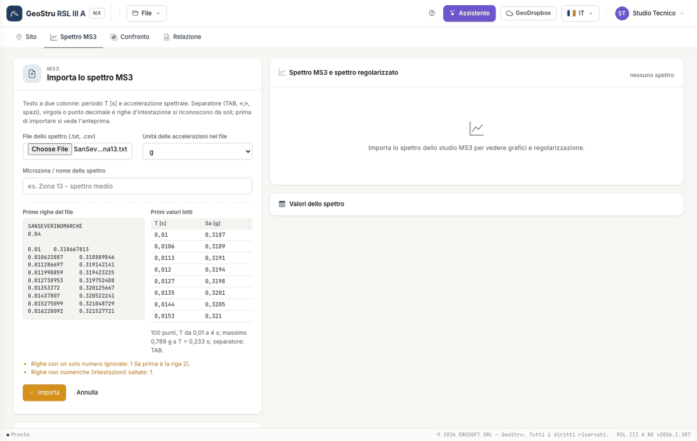
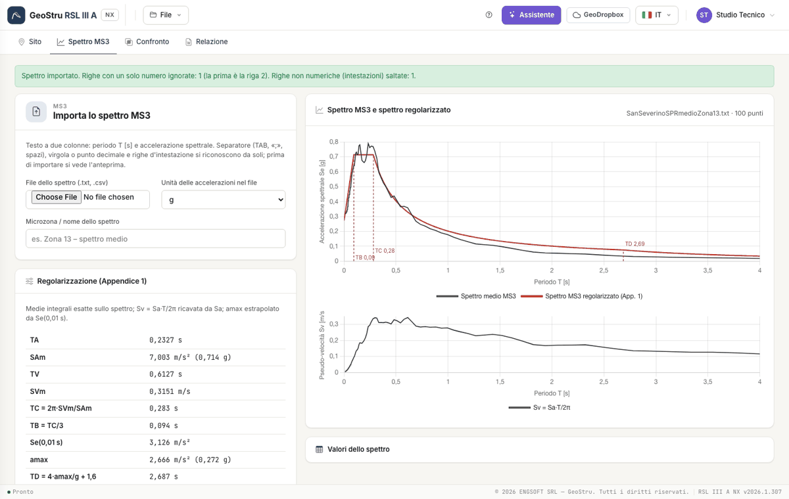

# MS3 spectrum

## The file

The spectrum of the MS3 study is a two-column text: **period T [s]** and **spectral acceleration**. The reader detects on its own:

- the separator: tab, semicolon, one or more spaces, or the comma between two numbers with a decimal point;
- the decimal separator: comma or point;
- the header lines (non-numeric), which it skips;
- the lines with a single number, which it discards with a warning (in the San Severino file the second line is «0.04»).

Columns beyond the second are ignored. The periods must be **strictly increasing**: if they are not, the import stops and tells you which line.
Choose the **unit** of the accelerations in the file (g or m/s²): if the maximum is suspect (more than 4 g, or less than 0.3 m/s²) a warning
appears.

## Preview and import

Once you choose the file, the preview shows the first lines as they are in the file and the first values read, with the number of points, the
range of periods and the maximum. Press **Import** to write it into the project, or **Cancel**. The **Microzone / spectrum name** field goes into
the report.

## Regularisation

As soon as it is imported, the spectrum is regularised according to Appendix 1 (formulas in [Theory](teoria.md)). The table shows T~A~, SA~m~,
T~V~, SV~m~, T~C~, T~B~, Se(0.01 s), a~max~, T~D~ and F~0~. The upper chart overlays the MS3 spectrum (black) and the regularised spectrum (red)
with the verticals of T~B~, T~C~ and T~D~; the lower one is the pseudo-velocity spectrum SV = SA·T/2π, always derived from SA.

!!! warning "Se(0.01 s)"
    Appendix 1 extrapolates a~max~ from the value of the spectrum at 0.01 s. If the file does not have that point, the value is interpolated; if
    the spectrum starts after 0.01 s, the regularisation cannot be done and the app tells you.

---

*Found an error on this page? [Let us know](mailto:info@geostru.ai?subject=Help%20RSL%20III%20A%20NX) or open a [Pull Request](https://github.com/EngSoft-Geostru/geostru-help-nx/edit/main/rsl3a/docs/en/spettro-ms3.md).*
