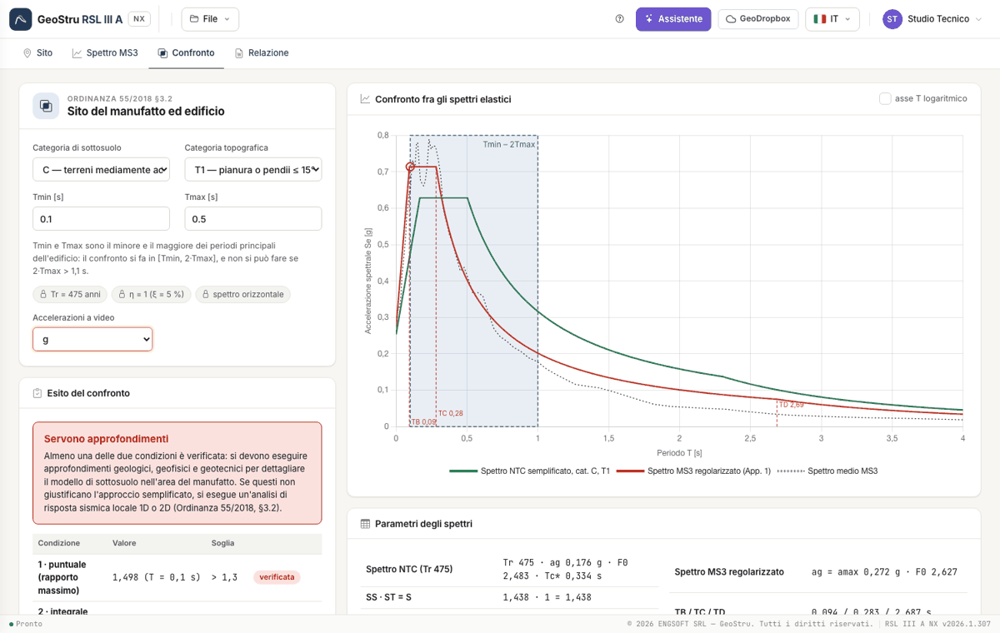

# Confronto

## Le scelte

- **Categoria di sottosuolo** (A–E) e **categoria topografica** (T1–T4) del sito del manufatto: danno S~S~, C~C~ e S~T~ dello spettro NTC.
- **T~min~** e **T~max~**: il minore e il maggiore dei periodi principali di vibrazione dell'edificio, dal calcolo strutturale. L'intervallo di
  confronto è **[T~min~, 2·T~max~]**: il fattore 2 tiene conto dell'allungamento del periodo durante il terremoto.
- **Accelerazioni a video**: g o m/s². Cambia solo la presentazione.

Sono fissati dall'Ordinanza e mostrati come tali: **T~R~ = 475 anni**, **η = 1** (smorzamento 5 %), **spettro orizzontale**.

## Il grafico

Spettro NTC semplificato (verde), spettro MS3 regolarizzato (rosso), spettro MS3 dello studio (punteggiato), banda [T~min~, 2·T~max~] e
verticali T~B~, T~C~, T~D~ del regolarizzato. Il cerchio segna il periodo del rapporto massimo. L'asse T può essere logaritmico.

## Le due condizioni

| Condizione | Che cosa si misura | Soglia |
|---|---|---|
| 1 — puntuale | il massimo del rapporto Se,MS3/Se,NTC nell'intervallo | > 1,30 |
| 2 — integrale | (A~MS3~ − A~NTC~)/A~NTC~, con A l'area sotto lo spettro nell'intervallo | > 20 % |

Un valore esattamente uguale alla soglia non la supera.

## L'esito

- **Approccio semplificato utilizzabile**: nessuna delle due condizioni è verificata.
- **Servono approfondimenti**: almeno una è verificata. Si eseguono approfondimenti geologici, geofisici e geotecnici; se non giustificano
  l'approccio semplificato, si fa un'analisi di risposta sismica locale 1D o 2D.
- **Confronto non effettuabile**: 2·T~max~ supera 1,1 s (nota 1 dell'Ordinanza). Le condizioni restano visibili come informazione.

Sotto le condizioni c'è, come informazione, la quota dei punti a passo 0,01 s in cui lo spettro MS3 supera quello di norma: è la lettura che
faceva il programma desktop, **non** la condizione 1 dell'Ordinanza. Il pallino colorato sulla linguetta **Confronto** riassume l'esito in ogni
scheda.

---

*Hai trovato un errore in questa pagina? [Segnalacelo](mailto:info@geostru.ai?subject=Help%20RSL%20III%20A%20NX) o apri una [Pull Request](https://github.com/EngSoft-Geostru/geostru-help-nx/edit/main/rsl3a/docs/it/confronto.md).*
