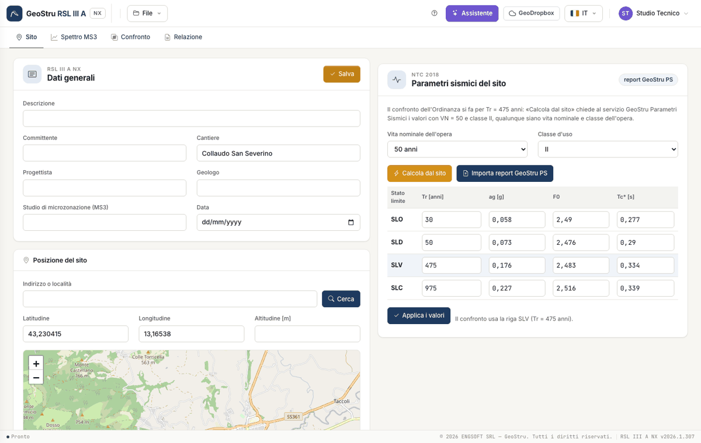
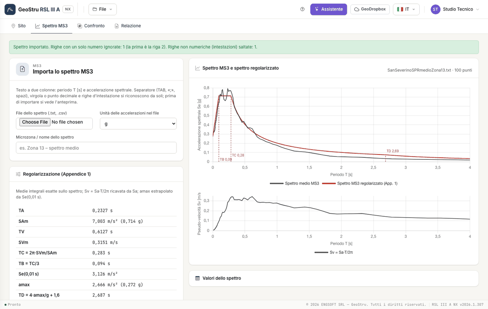
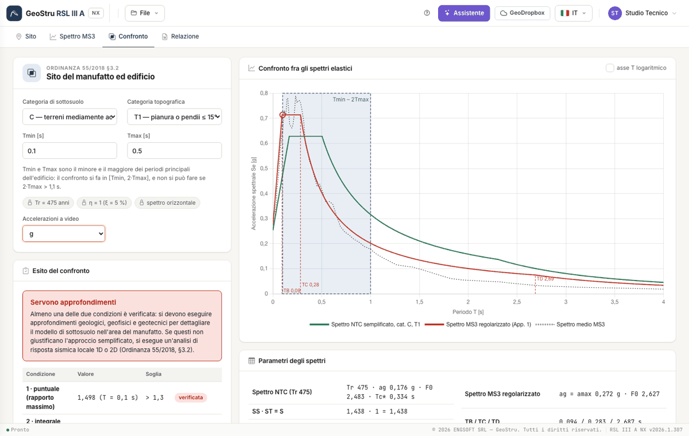

# Guida rapida (5 minuti)

Arrivi all'esito con l'esempio del manuale: San Severino Marche, microzona 13. Se hai già i tuoi file segui gli stessi passi con quelli.
Per vedere subito il risultato apri **File → Esempio**.

## 1. Il sito

Apri [nx.geostru.ai/rsl3a](https://nx.geostru.ai/rsl3a/). Nella scheda **Sito** scrivi il cantiere e posiziona il sito: clic sulla carta, oppure
latitudine e longitudine nei campi. Premi **Salva**. Poi premi **Calcola dal sito**: a~g~, F~0~ e T~c~* arrivano dal servizio GeoStru Parametri
Sismici, con la riga **SLV a 475 anni** usata dal confronto. In alternativa importa un report di GeoStru PS con **Importa report GeoStru PS**.

## 2. Lo spettro MS3

Nella scheda **Spettro MS3** scegli il file dello studio (testo a due colonne: periodo e accelerazione). L'anteprima mostra le prime righe del
file, i primi valori letti e gli avvisi: nel file di San Severino la riga «0.04», con un solo numero, viene scartata. Premi **Importa**: la
regolarizzazione si calcola subito.

## 3. Il confronto

Nella scheda **Confronto** scegli la **categoria di sottosuolo** (C nell'esempio) e quella **topografica** (T1), poi scrivi **T~min~ = 0,1 s** e
**T~max~ = 0,5 s**. Il grafico mostra lo spettro NTC (verde), lo spettro MS3 regolarizzato (rosso) e la banda [T~min~, 2·T~max~]. Il riquadro
dell'esito dice: rapporto massimo 1,498 → condizione 1 verificata; differenza fra le aree −17,2 % → condizione 2 non verificata;
**servono approfondimenti**.

## 4. La relazione

Nella scheda **Relazione** controlla l'**anteprima** e premi **Genera Word**. La relazione consuma crediti NX; anteprima e CSV sono gratuiti.

## Passi successivi

Il [Flusso di lavoro](workflow.md) spiega tutte le opzioni. Le formule sono in [Cenni teorici](teoria.md).

---

*Hai trovato un errore in questa pagina? [Segnalacelo](mailto:info@geostru.ai?subject=Help%20RSL%20III%20A%20NX) o apri una [Pull Request](https://github.com/EngSoft-Geostru/geostru-help-nx/edit/main/rsl3a/docs/it/quickstart.md).*
