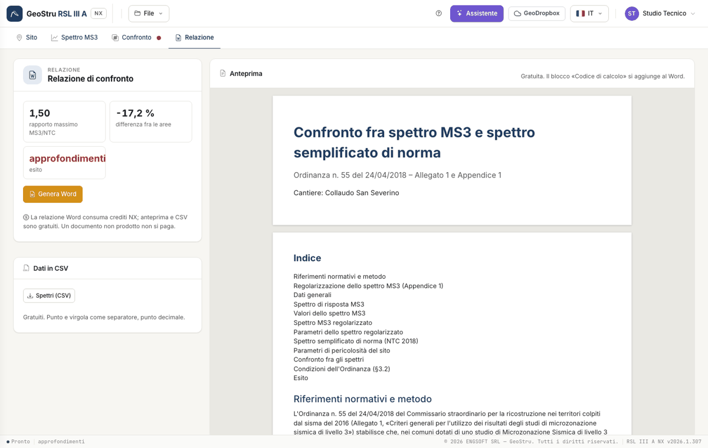

# Relazione e crediti

## Anteprima

La scheda **Relazione** mostra l'anteprima composta dal server con lo stesso codice del documento: è gratuita. Se manca qualcosa (spettro,
parametri, periodi) lo dice, con il collegamento alla scheda da completare.

## Il documento Word

**Genera Word** produce il documento nella lingua dell'interfaccia:

1. copertina con studio tecnico, committente, cantiere, località e data;
2. riferimenti normativi e metodo (Ordinanza n. 55 del 24/04/2018, §3.2) e regolarizzazione (Appendice 1, passi a–h);
3. dati generali, coordinate, vita nominale e classe d'uso;
4. spettro MS3: file, microzona, punti, massimo, grafico, pseudo-velocità e tabella dei valori;
5. spettro regolarizzato con i suoi parametri;
6. spettro semplificato di norma: fonte, T~R~, a~g~, F~0~, T~c~*, categorie, S~S~, C~C~, S~T~, T~B~, T~C~, T~D~, e i parametri dei quattro stati limite;
7. confronto: T~min~, T~max~, intervallo, grafico, tabella delle due condizioni con valore e soglia, esito;
8. blocco **«Codice di calcolo»** (NTC §10.2) con il codice del documento, verificabile su geostru.ai.

## Crediti

| Azione | Costo |
|---|---|
| Import, parametri, regolarizzazione, confronto, anteprima, CSV | gratuiti |
| Relazione Word | crediti NX |
| Messaggio all'assistente | crediti NX |

Un'operazione fallita non si paga, e rigenerare lo stesso documento con gli stessi dati non si ripaga. Con l'abbonamento all'app non si
consumano crediti.

## CSV

**Spettri (CSV)**, anche dal menu File: periodo, Se MS3, Se regolarizzato, Se NTC sui periodi dello spettro, separatore «;» e punto decimale.

---

*Hai trovato un errore in questa pagina? [Segnalacelo](mailto:info@geostru.ai?subject=Help%20RSL%20III%20A%20NX) o apri una [Pull Request](https://github.com/EngSoft-Geostru/geostru-help-nx/edit/main/rsl3a/docs/it/relazione.md).*
