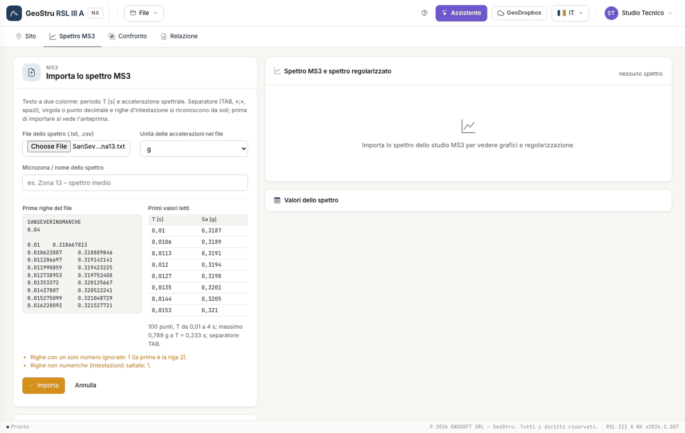
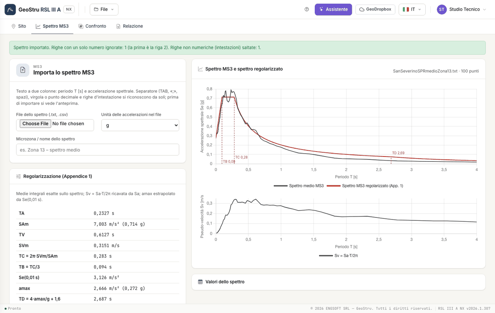

# Spettro MS3

## Il file

Lo spettro dello studio MS3 è un testo a due colonne: **periodo T [s]** e **accelerazione spettrale**. Il lettore riconosce da solo:

- il separatore: tabulatore, punto e virgola, uno o più spazi, oppure la virgola fra due numeri con il punto decimale;
- il separatore decimale: virgola o punto;
- le righe d'intestazione (non numeriche), che salta;
- le righe con un solo numero, che scarta con un avviso (nel file di San Severino la seconda riga è «0.04»).

Le colonne oltre la seconda si ignorano. I periodi devono essere **strettamente crescenti**: se non lo sono l'import si ferma e dice in quale
riga. Scegli l'**unità** delle accelerazioni del file (g o m/s²): se il massimo è sospetto (più di 4 g, o meno di 0,3 m/s²) compare un avviso.

## Anteprima e import

Scelto il file, l'anteprima mostra le prime righe come sono nel file e i primi valori letti, con il numero di punti, l'intervallo dei periodi e
il massimo. Premi **Importa** per scriverlo nel progetto, o **Annulla**. Il campo **Microzona / nome dello spettro** finisce in relazione.

## Regolarizzazione

Appena importato, lo spettro si regolarizza secondo l'Appendice 1 (formule in [Cenni teorici](teoria.md)). La tabella mostra T~A~, SA~m~, T~V~,
SV~m~, T~C~, T~B~, Se(0,01 s), a~max~, T~D~ e F~0~. Il grafico in alto sovrappone lo spettro MS3 (nero) e lo spettro regolarizzato (rosso) con le
verticali di T~B~, T~C~ e T~D~; quello in basso è lo spettro di pseudo-velocità SV = SA·T/2π, ricavato sempre da SA.

!!! warning "Se(0,01 s)"
    L'Appendice 1 estrapola a~max~ dal valore dello spettro a 0,01 s. Se il file non ha quel punto il valore si interpola; se lo spettro parte
    dopo 0,01 s la regolarizzazione non si può fare e l'app lo dice.

---

*Hai trovato un errore in questa pagina? [Segnalacelo](mailto:info@geostru.ai?subject=Help%20RSL%20III%20A%20NX) o apri una [Pull Request](https://github.com/EngSoft-Geostru/geostru-help-nx/edit/main/rsl3a/docs/it/spettro-ms3.md).*
