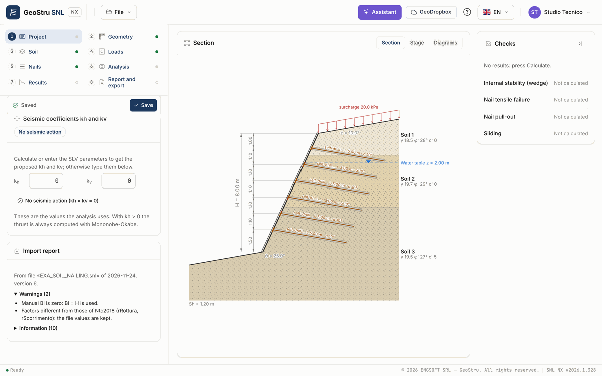

# Importing .snl files

SNL NX opens SNL `.snl` projects and converts them into its own model. The original file is not modified.

## How to import

1. Save the current work if you want to keep it.
2. Choose **File → Open…** and select the `.snl` file.
3. Read the message that appears: it says how many items were not imported and how many warnings there are.
4. Open the **Project** step and read the **Import report** at the bottom of the page.
5. Check the steps one by one and calculate again.

The files read are those of the known versions of the format; a more recent version is read as the last known one and the report says so. An empty or truncated file, or one that is not an SNL project, is rejected and the project on screen stays as it was.

## The import report

The report gives the file name, date and version, and groups the items in three groups:

| Group | Meaning |
|---|---|
| **Information** | notes on the conversion, file data that SNL NX does not use |
| **Warnings** | choices made to represent a value of the file: to be checked |
| **Items not imported** | data that do not enter the project |

The report stays with the project also when you save it as `.snlnx`.

## What changes in the model

### Results are recalculated

The results saved in the file are not imported: the analysis is run again with the SNL NX engine. Differences from the numbers saved in the file may come from the corrections to the method described in [Validation and limits](validazione.md).

### Nails in order of depth

If the nails in the file are not in order of depth, they are reordered and the report gives the original order. The analysis always takes the stages in order of depth.

### Default values

- a kn ≤ 0 becomes **0.85**;
- a zero nail-soil interaction K becomes **1**;
- a zero manual Bl becomes **Bl = H**;
- an invalid manual β becomes **45° + φ'/2**;
- an unknown code (design code, theory, method) takes the default value, and the report says which one.

The report lists the layers and nails concerned.

### Line loads

In earlier versions the distance of a line load could be read as a ratio to the wall height. SNL NX reads it **in metres from the top of the wall**; the report also gives where the load would have been with the earlier reading, so you can correct the value if needed.

### Factors

The A, M, R and ξ factors of the file are kept even if different from those of the chosen code: the report lists the different ones. If there are fewer load factors A than loads, the missing ones are 1; extra ones are discarded.

### Data left out

They do not enter the project, and the report lists them with their value: description, identifier, date and coordinates of the file (coordinates are entered again in the Project step), point of application of the thrust, second stretch of the backslope, facing type, water table type and impermeable wall, nail descriptions and archive data, soil and nail archives.

Empty rows of the lists are discarded; a file not in UTF-8 is read as Windows-1252.

## Menu examples

The examples in **File → Examples** are `.snl` projects imported on the fly, without a report. Save them as `.snlnx` if you want to start from one of them.

---

*Found an error on this page? [Let us know](mailto:info@geostru.ai) or open a [Pull Request](https://github.com/EngSoft-Geostru/geostru-help-nx/edit/main/snl/docs/en/importazione.md).*
