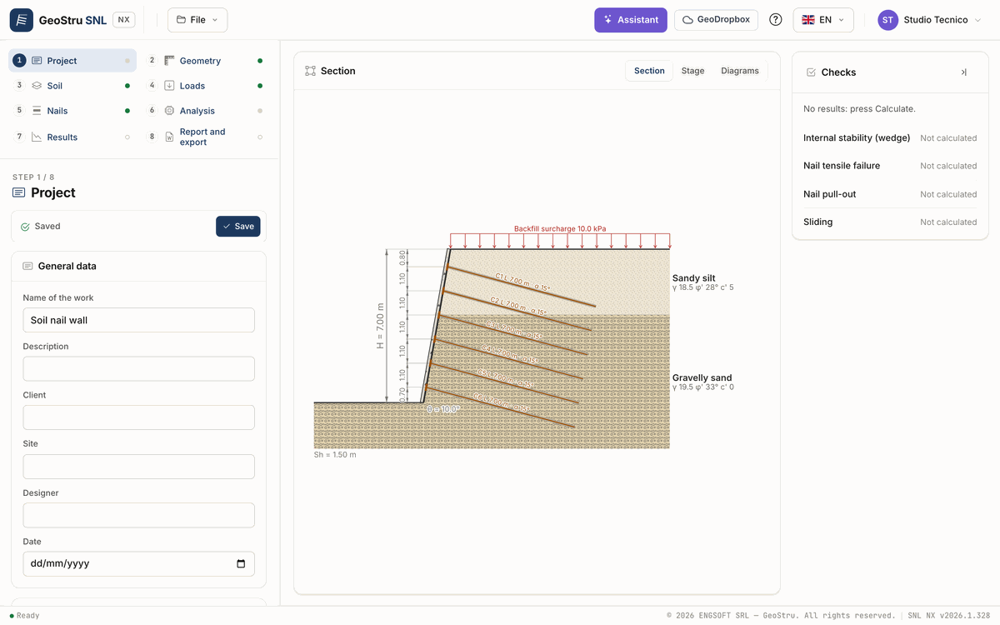

# SNL NX

**SNL NX** is the GeoStru app for the design and checking of **soil nail walls**: excavation faces supported by passive nails and a thin shotcrete facing, built from the top down in lifts.

The drawing in the centre shows the wall section while you build it. The panel on the right summarises the checks after the analysis.

[**Open SNL NX**](https://nx.geostru.ai/snl/){ .md-button .md-button--primary }

## Who it is for

It is for the geotechnical designer who has to size or check a soil nail wall, temporary or permanent. You can start from a new project, from an example or from a `.snl` file.

## What it does

- computes the force in each nail from the active earth pressure on its zone of influence, with Rankine or Coulomb and, under seismic action, Mononobe-Okabe;
- derives the **excavation stages** by itself, one per nail, and checks the **internal stability** of the soil wedge in each of them;
- checks every nail for **tensile failure** and **pull-out**, in every stage;
- checks **sliding** of the nailed block on the foundation soil;
- plots pressure, shear and bending moment on the **facing**;
- handles layered soil, water table, uniform, strip and line surcharges, pseudo-static seismic action;
- uses the partial factors of NTC 2018 or Eurocode 7, or factors of your choice;
- proposes kh and kv from the site seismic parameters;
- imports `.snl` files with an import report;
- produces the Word report and the DXF drawing of the section.

The method follows the US guidelines FHWA-NHI-14-007 and, for internal stability, the wedge method of Sheahan & Ho (2003). The theory is in [Theory](teoria.md).

## The eight steps

| Step | What it contains |
|---|---|
| 1. Project | general data, code and structure type, site location, seismic parameters, kh and kv, import report |
| 2. Geometry | height H, facing inclination θ, backslope inclination ε, drawing data |
| 3. Soil | layers from the top with their parameters, nail-soil interaction K, water table |
| 4. Loads | uniform loads, strip loads, line loads, each with its own factor A |
| 5. Nails | horizontal spacing and the list of nails; constant vertical spacing, same data for all, sorting |
| 6. Analysis | earth pressure theory, failure surface β, base Bl, combination and factors, **Calculate** button |
| 7. Results | stages, nails, sliding, facing diagrams |
| 8. Report and export | Word report and DXF drawing |

Each step is described in the [Workflow](workflow.md).

## Free and with credits

Modelling, **analysis**, on-screen drawing and results do not use credits. The Word report and the DXF drawing use **10 credits** each; every message to the assistant uses **3**. A failed operation is not charged. See [Credits](crediti.md).

## Session and saving

The project stays in the session for **30 minutes of inactivity**. Save it with **File → Save** or **Save as…** to a `.snlnx` file, or to **GeoDropbox**.

!!! warning "Note"
    «Saved» in the step bar means saved in the session, not in a file on your computer.

## Manual map

| Chapter | Content |
|---|---|
| [Quick start](quickstart.md) | the File menu example, the analysis and reading the checks |
| [Workflow](workflow.md) | the eight steps, field by field |
| [Theory](teoria.md) | excavation stages, nail forces, checks, seismic action, partial factors |
| [Importing .snl files](importazione.md) | how to open a `.snl` and read the report |
| [Formats](formati.md) | `.snlnx`, `.snl`, Word, DXF and GeoDropbox |
| [Credits](crediti.md) | free actions, rates and failed operations |
| [AI assistant](assistente.md) | what it reads, calculates and changes |
| [Validation and limits](validazione.md) | scope, method assumptions, test cases |
| [Frequently asked questions](faq.md) | answers to common doubts |

---

*Found an error on this page? [Let us know](mailto:info@geostru.ai) or open a [Pull Request](https://github.com/EngSoft-Geostru/geostru-help-nx/edit/main/snl/docs/en/index.md).*
