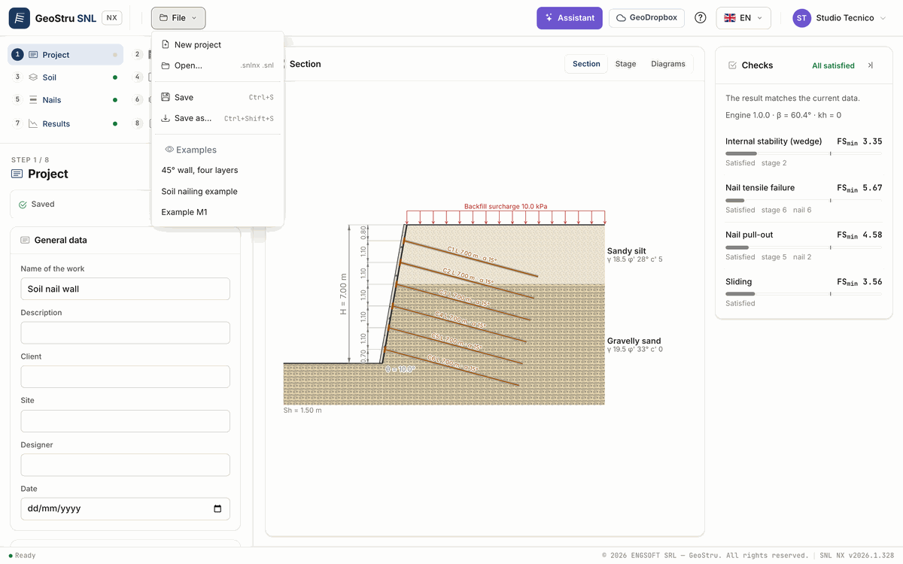
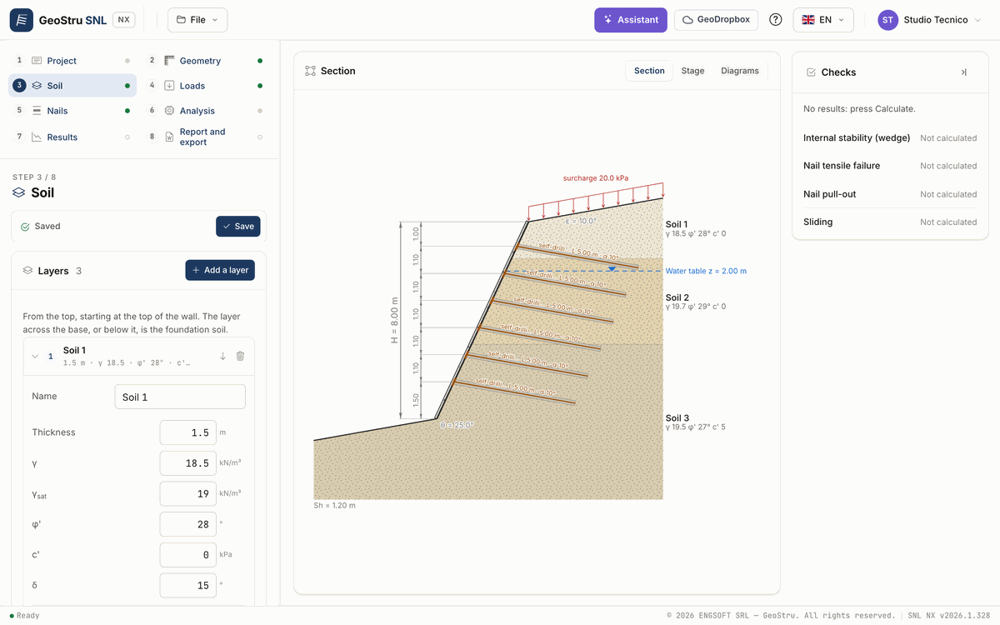
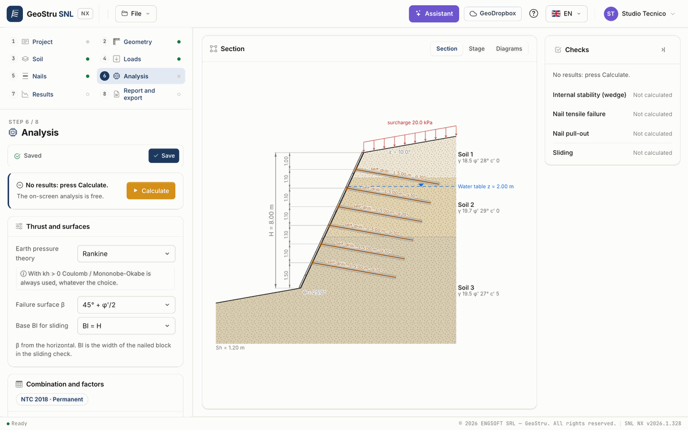
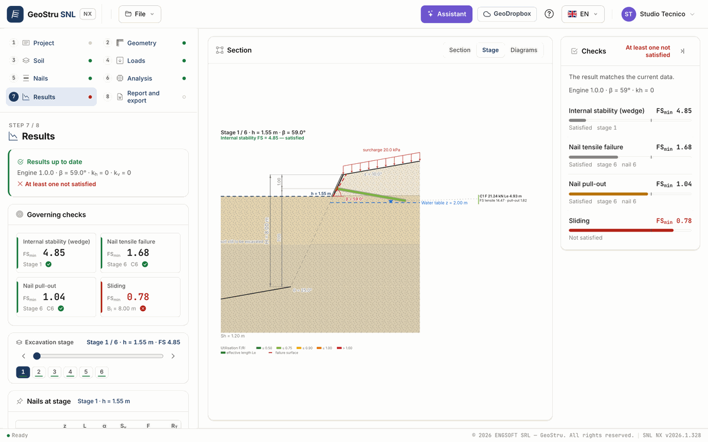

# Quick start (5 minutes)

Use the **Soil nailing example** in the File menu: an 8 m high wall with the facing inclined at 25°, backslope at 10°, three layers, water table 2 m below the top, a 20 kPa uniform surcharge and six 5 m long nails.

## 1. Open the example

Open [SNL NX](https://nx.geostru.ai/snl/). In the **File** menu choose **Examples → Soil nailing example**.

If the project on screen has changes that are not in a file, the program tells you before replacing it. The example takes the place of the current project.

## 2. Check the model

Go through the steps in order, on the left:

1. **Project**: code and structure type, kh and kv. The example has no seismic action (kh = kv = 0).
2. **Geometry**: H = 8 m, θ = 25°, ε = 10°.
3. **Soil**: three layers from the top and the water table 2 m below the top of the wall. Next to the **Nail-soil interaction K** of each layer you find the value proposed from φ'.
4. **Loads**: the uniform surcharge and its **Factor A**.
5. **Nails**: the horizontal spacing Sh and the six nails, each with depth, length, inclination, diameters, fy and kn.

The drawing in the centre is updated at every change: check levels, layers, water table, loads and nails. A step with missing or invalid data is flagged in the list on the left and the messages tell you which field to fix.

## 3. Calculate

Open **Analysis**. Check:

- **Earth pressure theory**: Rankine or Coulomb (with kh > 0 Coulomb / Mononobe-Okabe is always used);
- **Failure surface β**: 45° + φ'/2 or a manual value;
- **Base Bl for sliding**: Bl = H, manual or automatic;
- **Combination and factors**: ξ, A, M and R loaded from the code chosen in the Project step.

Press **Calculate**. The analysis is free and takes a moment. If it stops, the message above the button says why and which step to fix.

## 4. Read the checks

The **Checks** panel on the right summarises the four families:

- **Internal stability (wedge)**: the minimum safety factor over the stages and the stage where it occurs;
- **Nail tensile failure** and **Nail pull-out**: the minimum over all nails and all stages, with the governing nail;
- **Sliding**: the safety factor of the nailed block.

In the example look in particular at sliding: with the water table 2 m below the top, the water thrust weighs heavily on the block. Try lowering the water table or lengthening the nails and calculate again: the previous result becomes «out of date» as soon as you change a value.

The **Results** step shows the details by stage and by nail, sliding and the facing diagrams. See [Workflow](workflow.md#7-results).

## 5. Report and export

With an up-to-date analysis, open **Report and export** to download the Word report or the DXF drawing of the section (10 credits each). See [Credits](crediti.md).

## 6. Save the project

Use **File → Save as…** to download a `.snlnx`. The file keeps the inputs; results are recalculated after opening. You can also save the project to **GeoDropbox**. Do not leave your only copy in the session: it expires after 30 minutes of inactivity.

!!! tip "Ask the assistant"
    The **Assistant** button opens the chat: you can ask it to run the analysis and explain which stage or which nail governs. See [AI assistant](assistente.md).

---

*Found an error on this page? [Let us know](mailto:info@geostru.ai) or open a [Pull Request](https://github.com/EngSoft-Geostru/geostru-help-nx/edit/main/snl/docs/en/quickstart.md).*
