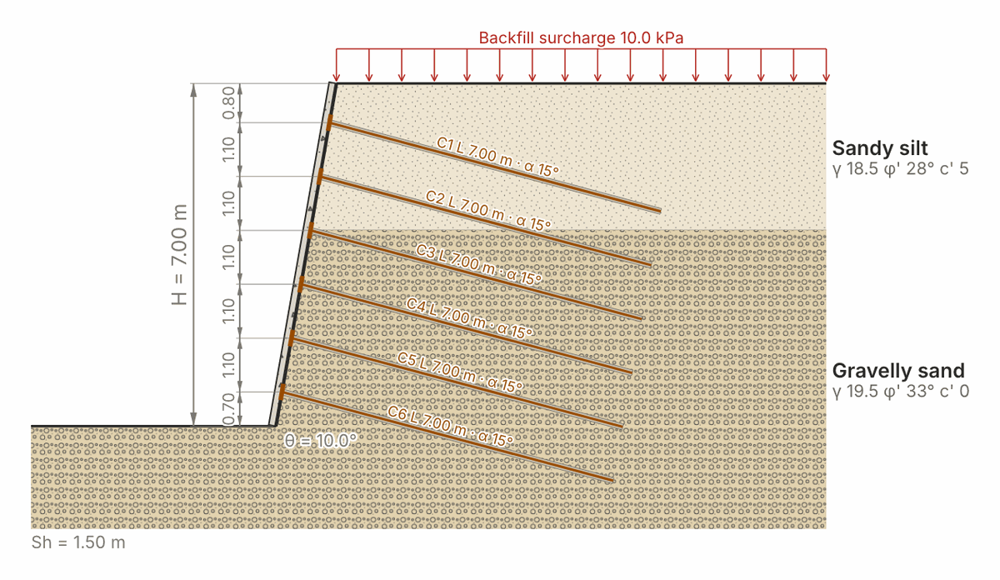
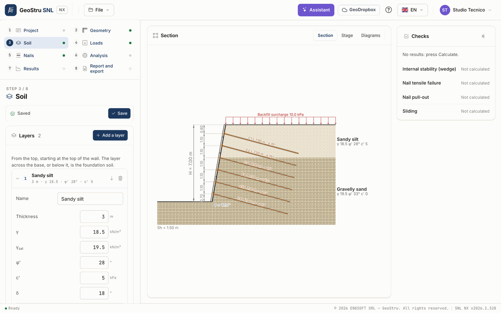
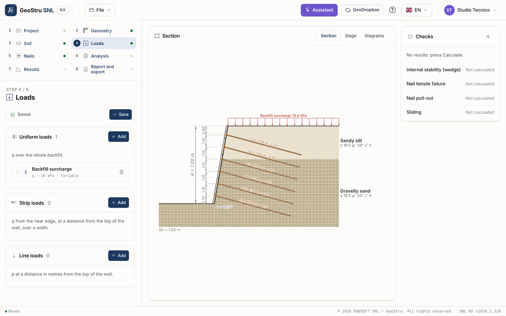
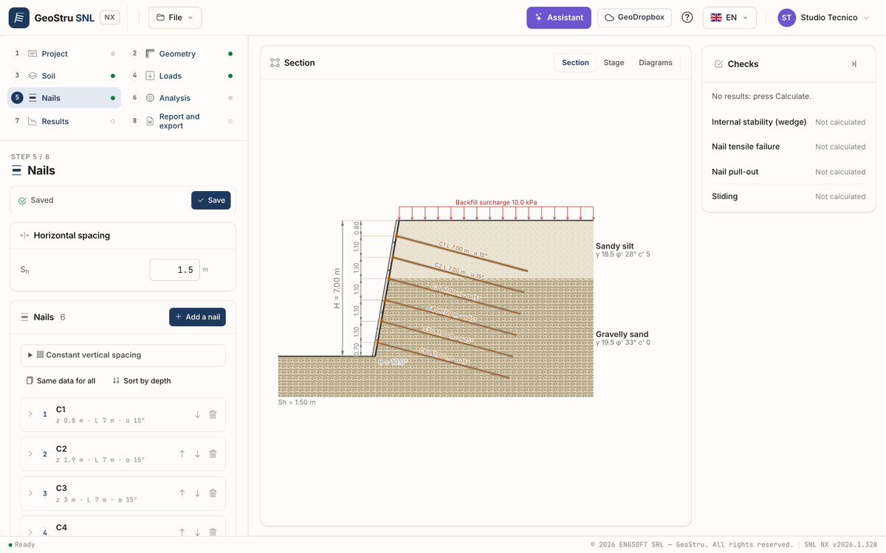
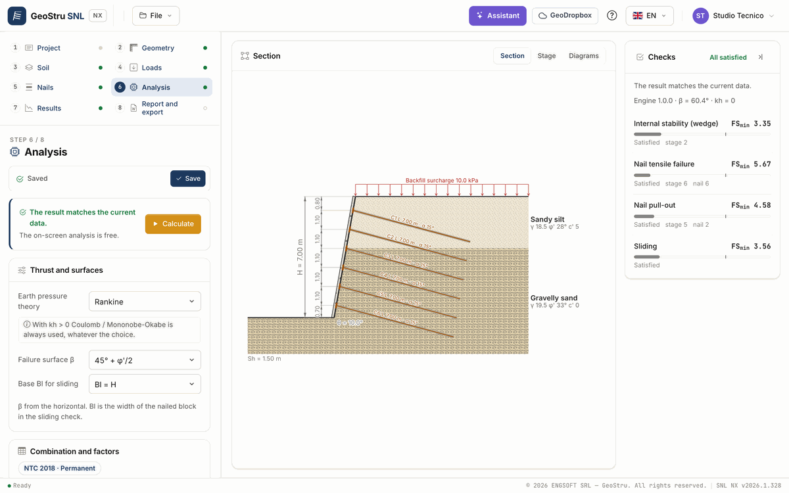
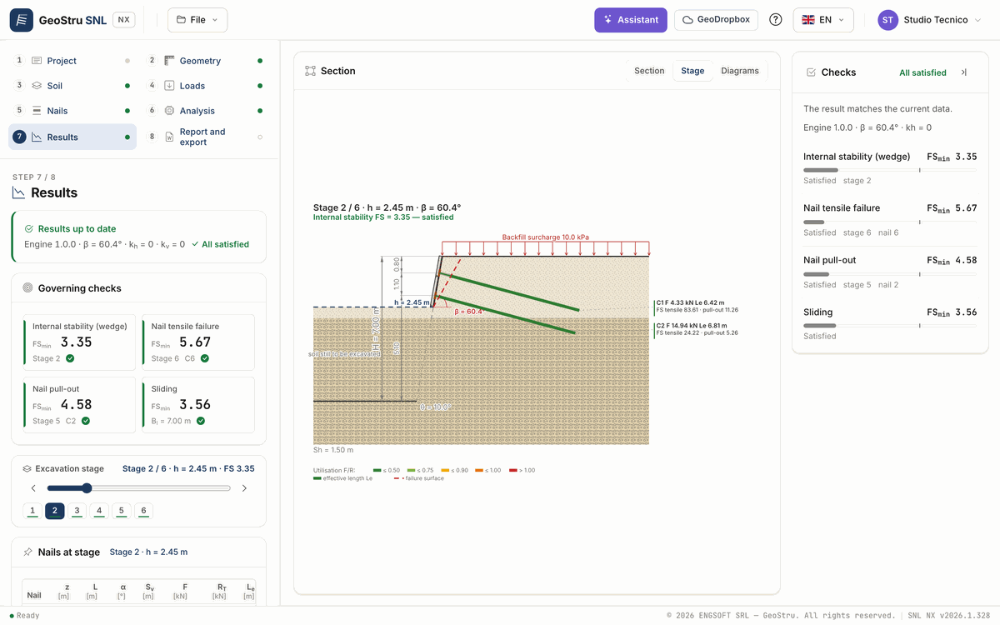
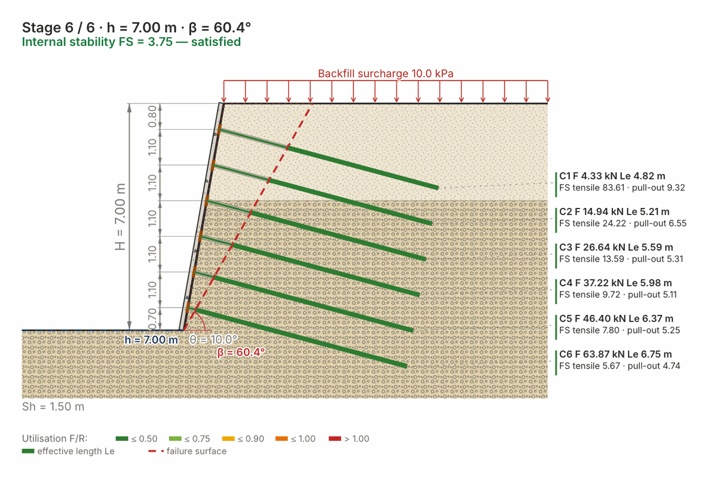
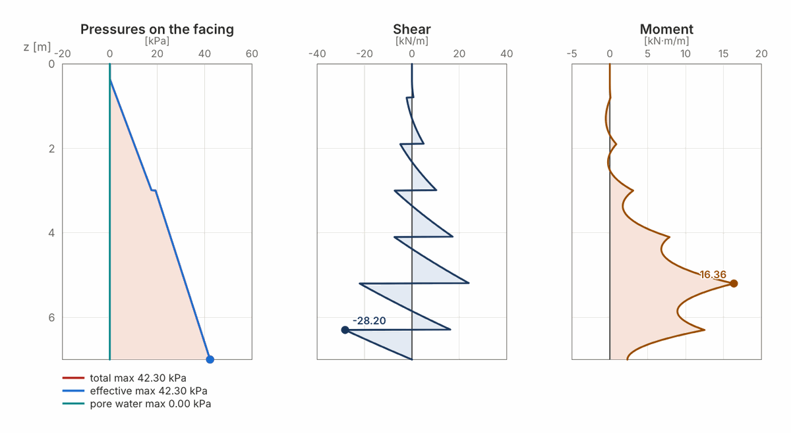
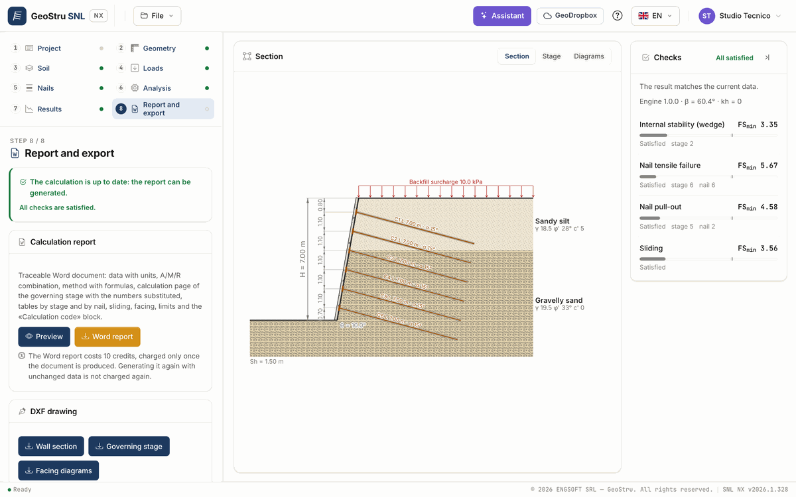

# Workflow

SNL NX has eight steps, listed on the left. Each step saves what you type by itself; the status next to the name says whether it is **Completed**, **To complete** or **To be corrected**. In the centre the section drawing is updated at every change; on the right the **Checks** panel summarises the analysis.

Units: metres, kN, kPa, kN/m³, degrees; fy in MPa. Depths are measured **from the top of the wall, downwards**. Bar and drillhole diameters are in **metres** (0.032 m, not 32).

## 1. Project

### General data

**Name of the work** (the title of the report), **Description**, **Client**, **Site**, **Designer**, **Date**, **Address or locality**. The **Design office** section (heading, address, contacts, VAT number) appears in the report heading.

### Code and structure

- **Code**: **NTC 2018**, **Eurocode 7** or **User (free coefficients)**;
- **Structure**: **Permanent** or **Temporary**.

!!! warning "Factors"
    Changing code or structure type reloads the A, M, R and ξ factors of the **Analysis** step: hand-written ones are lost.

### Site location

Search the address with **Search**, click on the map or drag the marker: **Latitude** and **Longitude** are updated.

### Site seismic parameters

Set **Nominal life VN**, **Use class**, **Ground category** and **Topographic category**; the reference period VR = VN·CU is computed. **Calculate from the site** asks the GeoStru Seismic Parameters service for ag, F0 and Tc* at each limit state; alternatively type the values in the table and press **Apply the table values**.

### Seismic coefficients kh and kv

These are the values the analysis uses. You have three options:

- **Proposal from the site (SLV)**: from the SLV parameters the app proposes kh = βm·amax/g and kv = ±0.5·kh. βm is 0.38 unless you change it. Choose the **Sign of kv** and press **Apply the proposed kh and kv**. The proposal does not enter the analysis until you apply it;
- **by hand**: type kh and kv in the fields;
- **No seismic action (kh = kv = 0)**.

With kh > 0 the thrust is always computed with Mononobe-Okabe, whatever theory is chosen in the Analysis step.

### Import report

If the project comes from a `.snl` file, the **Import report** is at the bottom of the step. See [Importing](importazione.md).

## 2. Geometry

- **Height H** of the wall [m];
- **Facing inclination θ** [°], from the vertical, with the top towards the backfill;
- **Backslope inclination ε** [°]: the slope behind the wall is taken as infinite.

The **Drawing only** section (length of the uphill and downhill stretches, downhill inclination, facing thickness) is used for the drawing and the bill of quantities, not for the analysis.

## 3. Soil

### Layers

Layers go **from the top**, starting at the top of the wall. For each layer: **Name**, **Thickness** [m], γ and γsat [kN/m³], φ' [°], c' [kPa], δ [°] and **Nail-soil interaction K**, plus a description.

- δ is the wall-soil friction (Coulomb theory) and the nail-soil friction (pull-out resistance);
- next to K you find the value **Proposed from φ'**: **Use** copies it into the field. K = 0 counts as 1 in the analysis;
- the layer across the base, or the first below it, is the **foundation soil** of the sliding check. The total thickness of the layers must exceed H.

The arrows move a layer up or down; the bin deletes it after a confirmation.

### Water table

Tick **Water table present** and give the **Depth from the top of the wall**. The water table is hydrostatic: γsat is used below it and the water thrust is considered.

## 4. Loads

Three lists of surcharges behind the wall, each with **Description**, **Category** (Permanent, Variable, Accidental) and **Factor A**:

| List | Data |
|---|---|
| **Uniform loads** | q [kPa] over the whole backfill |
| **Strip loads** | q [kPa], **Distance of the near edge** from the top of the wall and **Width** [m] |
| **Line loads** | p [kN/m] and **Distance from the top** [m] |

The factor A of each load is typed by hand: the category describes the load, it does not set the factor.

## 5. Nails

**Horizontal spacing** Sh [m], one for the whole wall. Then the list of nails, one per row:

| Field | Unit | Notes |
|---|---|---|
| **Name** | | optional |
| **Head depth** | m | from the top of the wall, downwards |
| **Length L** | m | |
| **Inclination α** | ° | below the horizontal |
| **Drillhole diameter** | m | enters the pull-out resistance |
| **Bar from the archive** | | choose a bar to copy its diameter and fy |
| **Bar diameter** | m | enters the tensile resistance |
| fy | MPa | steel strength |
| kn | | reduces the thrust on the nail; ≤ 0 counts as 0.85 |

Commands of the list:

- **Constant vertical spacing**: give **Depth of the first nail**, **Vertical spacing** and **Number of nails** and press **Apply**. Existing nails keep their data and change depth; new ones copy the last; those beyond the number are removed;
- **Same data for all**: copies L, α, diameters, fy and kn of the open nail (or the first) to all the others;
- **Sort by depth**.

The analysis always considers the nails in order of depth. Two nails at the same depth or a nail below the toe of the wall are errors.

## 6. Analysis

### Thrust and surfaces

- **Earth pressure theory**: **Rankine** or **Coulomb**. With kh > 0 Coulomb / Mononobe-Okabe is always used;
- **Failure surface β**: **45° + φ'/2** (with the mean φ' of the stage) or **Manual** (manual β, from the horizontal);
- **Base Bl for sliding**: **Bl = H**, **Manual** (manual Bl) or **Automatic** (from the projection of the first nail). Bl is the width of the nailed block in the sliding check.

### Combination and factors

A **Combination name** and the factors, loaded from the code chosen in the Project step and editable:

- ξ: correlation factor for the number of investigated profiles, divides the pull-out resistance;
- **A factors (actions)**: **A weight** and **A seismic** (the factor A of each load is in the Loads step);
- **M factors (soil)**: γφ' (reduces tan φ'), γc', γδ;
- **R factors (resistances)**: **R nail failure**, **R pull-out**, **R sliding**, **R internal checks**.

See [Partial factors](teoria.md#partial-factors).

### Calculate

Press **Calculate**. The on-screen analysis is free. Above the button you read the status:

- «The result matches the current data»;
- «The result is out of date: the data changed after the analysis» — calculate again;
- the reason why the analysis stopped (invalid data, earth pressure coefficient not computable, invalid β…).

Validation errors block the analysis; warnings do not.

## 7. Results

The **Results** step shows the result of the last analysis, if it is up to date:

- **excavation stages**: for each stage the excavation depth, the mean parameters, the wedge weight W, the loads Q, the water thrust U, the nail contribution S and the internal stability safety factor, with the governing stage highlighted;
- **nails**: for each nail the zone of influence, the force F, the tensile resistance RT and, stage by stage, the effective length Le, the pull-out resistance and the safety factors;
- **sliding**: base Bl, height H1, block weight, soil, surcharge and water thrusts, resistance and safety factor;
- **facing**: pressure, shear and moment diagrams along the facing.

Above the drawing, the result views show the chosen stage with the failure surface and the diagrams. An infinite safety factor (unloaded nail) is written «—».

The **Checks** panel on the right gives the minimum of each family with the governing stage and nail. «Out of date» means you changed a value after the analysis.

## 8. Report and export

With an up-to-date analysis you can download:

- the **Word report**: data, assumptions, results by stage and by nail, sliding, diagrams and the «Calculation code» block with the document code that can be checked on geostru.ai;
- the signed **DXF drawing** of the section.

Each uses 10 credits; a document that is not produced is not charged. See [Credits](crediti.md) and [Formats](formati.md).

---

*Found an error on this page? [Let us know](mailto:info@geostru.ai) or open a [Pull Request](https://github.com/EngSoft-Geostru/geostru-help-nx/edit/main/snl/docs/en/workflow.md).*
