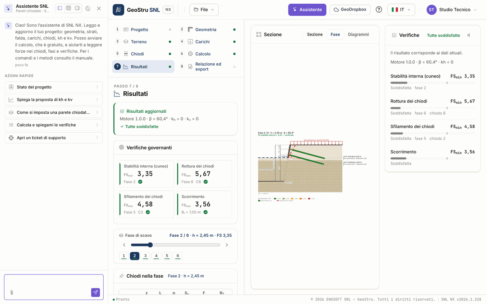

# Assistente AI

Il pulsante **Assistente** apre la chat. L'assistente è un sistema di intelligenza artificiale che lavora sul progetto aperto; se glielo chiedi, lo dichiara.

## Cosa legge

- il progetto, tutto o un passo alla volta, con gli errori e gli avvisi di validazione;
- il sito e la proposta di kh e kv;
- il rapporto di importazione;
- lo stato del calcolo e i **risultati**: sintesi delle verifiche, fasi, singoli chiodi, scorrimento, strati, rivestimento;
- questo manuale.

Per le domande su comandi, passi, metodi e messaggi consulta il manuale prima di rispondere, poi collega la spiegazione al tuo progetto.

## Cosa fa

- **calcola** la parete con i dati attuali, come il pulsante **Calcola**: il calcolo è gratuito;
- aggiorna un passo del progetto su tua richiesta (geometria, strati, falda, carichi, chiodi, coefficienti, kh e kv);
- applica ai chiodi un **interasse verticale costante** o gli **stessi dati per tutti**, come i comandi del passo Chiodi.

Prima di modificare legge i dati correnti e conserva ciò che non hai chiesto di cambiare. Dopo la scrittura riporta gli errori e gli avvisi di validazione. Mentre lavora, le modifiche dalla pagina sono sospese; al termine la pagina si ricarica se il progetto o il calcolo sono cambiati.

## Cosa non fa

- non inventa parametri del terreno, quote, coefficienti o dati del cantiere;
- non stima a mente spinte, forze o fattori di sicurezza: i numeri vengono dal calcolo;
- non dichiara verificata una parete senza un risultato aggiornato;
- non toglie strati, chiodi, carichi, la falda o il sisma senza una tua richiesta esplicita;
- non genera la relazione Word o la tavola DXF;
- non sostituisce il giudizio del progettista.

## Esempi di richieste

- «Che cosa manca per calcolare?»
- «Calcola e dimmi quale fase governa la stabilità interna.»
- «Perché il chiodo 4 non è verificato a sfilamento?»
- «Metti otto chiodi a partire da 0,8 m con interasse 1,1 m.»
- «Spiegami la proposta di kh e kv.»
- «Leggi il rapporto di importazione e dimmi cosa controllare.»

I chiodi si indicano con il numero della loro riga nel passo Chiodi; le fasi seguono l'ordine di profondità dello scavo.

## Costo e limiti

Ogni messaggio costa **3 crediti NX**. Un messaggio finito in errore o senza risposta non si paga; le modifiche fatte prima dell'errore restano nel progetto.

Un messaggio può contenere al massimo 20 000 caratteri, allegato compreso, e un numero limitato di operazioni: se l'assistente raggiunge il limite, chiedigli di proseguire. C'è anche un limite mensile di utilizzo.

## Supporto

L'azione rapida **Apri un ticket di supporto** avvia una richiesta all'assistenza. Finché il ticket è aperto, i messaggi vanno all'operatore.

---

*Hai trovato un errore in questa pagina? [Segnalacelo](mailto:info@geostru.ai) o apri una [Pull Request](https://github.com/EngSoft-Geostru/geostru-help-nx/edit/main/snl/docs/it/assistente.md).*
