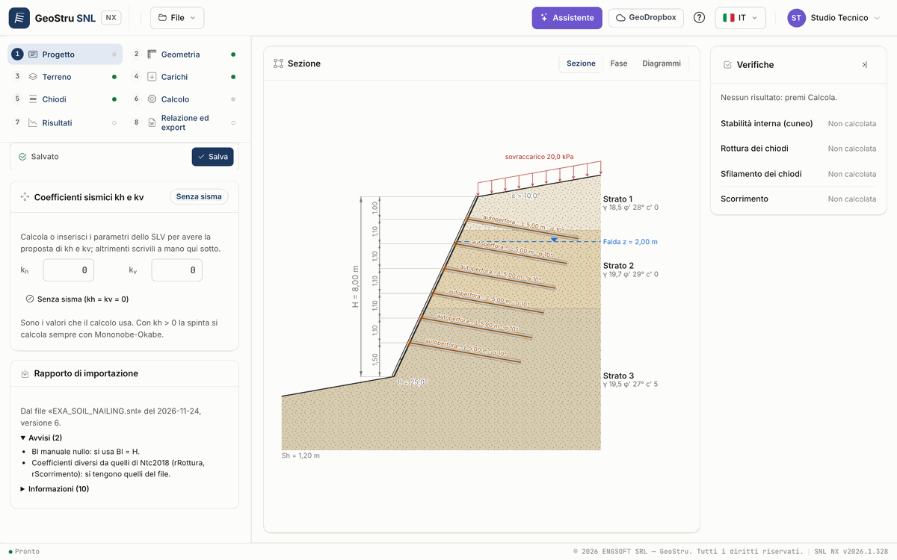

# Importazione dei file .snl

SNL NX apre i progetti `.snl` di SNL e li converte nel proprio modello. Il file originale non viene modificato.

## Come importare

1. Salva il lavoro corrente se vuoi conservarlo.
2. Scegli **File → Apri…** e seleziona il file `.snl`.
3. Leggi il messaggio che compare: dice quanti dati non sono stati importati e quanti avvisi ci sono.
4. Apri il passo **Progetto** e leggi il **Rapporto di importazione** in fondo alla pagina.
5. Controlla i passi uno per uno e calcola di nuovo.

I file letti sono quelli delle versioni note del formato; una versione più recente viene letta come l'ultima nota e il rapporto lo dice. Un file vuoto, troncato o che non è un progetto SNL viene rifiutato e il progetto a video resta com'era.

## Il rapporto di importazione

Il rapporto riporta nome del file, data e versione, e raggruppa le voci in tre gruppi:

| Gruppo | Significato |
|---|---|
| **Informazioni** | note sulla conversione, dati del file che SNL NX non usa |
| **Avvisi** | scelte fatte per rappresentare un dato del file: da controllare |
| **Dati non importati** | dati che non entrano nel progetto |

Il rapporto resta con il progetto anche quando lo salvi come `.snlnx`.

## Cosa cambia nel modello

### I risultati si ricalcolano

I risultati salvati nel file non vengono importati: il calcolo si rifà con il motore di SNL NX. Le differenze rispetto ai numeri salvati nel file possono venire dalle correzioni del metodo descritte in [Validazione e limiti](validazione.md).

### Chiodi in ordine di profondità

Se nel file i chiodi non sono in ordine di profondità, vengono riordinati e il rapporto riporta l'ordine originale. Il calcolo considera sempre le fasi in ordine di profondità.

### Valori predefiniti

- un kn ≤ 0 diventa **0,85**;
- un K di interazione chiodo-terreno nullo diventa **1**;
- una Bl manuale nulla diventa **Bl = H**;
- una β manuale non valida diventa **45° + φ'/2**;
- un codice sconosciuto (normativa, teoria, metodo) prende il valore predefinito, e il rapporto dice quale.

Il rapporto elenca gli strati e i chiodi interessati.

### Carichi lineari

Nelle versioni precedenti la distanza di un carico lineare poteva essere letta come rapporto con l'altezza della parete. SNL NX la legge **in metri dalla testa della parete**; il rapporto indica anche dove sarebbe stato il carico con la lettura precedente, così puoi correggere il dato se serve.

### Coefficienti

I coefficienti A, M, R e ξ del file si conservano anche se diversi da quelli della normativa scelta: il rapporto elenca quelli diversi. Se i coefficienti A dei carichi sono meno dei carichi, i mancanti valgono 1; quelli in più si scartano.

### Dati che restano fuori

Non entrano nel progetto, e il rapporto li elenca con il loro valore: descrizione, identificativo, data e coordinate del file (le coordinate si reinseriscono nel passo Progetto), punto di applicazione della spinta, secondo tratto del terreno a monte, tipo di rivestimento, tipo di falda e parete impermeabile, descrizioni e dati d'archivio dei chiodi, archivi dei terreni e dei chiodi.

Le righe vuote degli elenchi si scartano; un file non in UTF-8 si legge come Windows-1252.

## Gli esempi del menu

Gli esempi del menu **File → Esempi** sono progetti `.snl` importati al volo, senza rapporto. Salvali come `.snlnx` se vuoi partire da uno di essi.

---

*Hai trovato un errore in questa pagina? [Segnalacelo](mailto:info@geostru.ai) o apri una [Pull Request](https://github.com/EngSoft-Geostru/geostru-help-nx/edit/main/snl/docs/it/importazione.md).*
