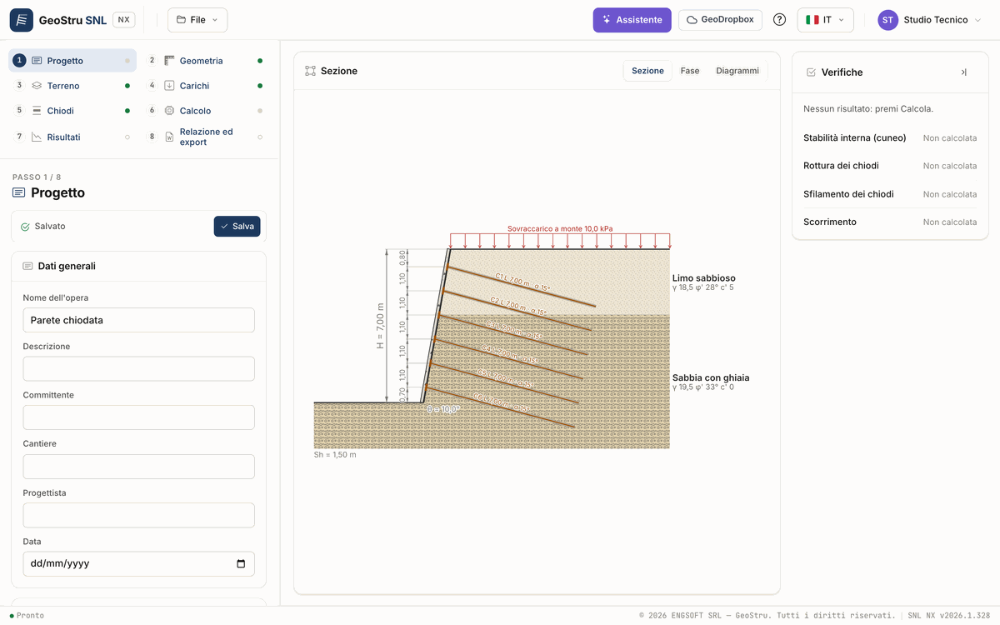

# SNL NX

**SNL NX** è l'app GeoStru per il progetto e la verifica delle **pareti chiodate** (soil nailing): fronti di scavo sostenuti da chiodi passivi e da un rivestimento sottile in spritz-beton, realizzati dall'alto verso il basso a gradini.

Il disegno al centro mostra la sezione della parete mentre la componi. Il pannello a destra riassume le verifiche dopo il calcolo.

[**Apri SNL NX**](https://nx.geostru.ai/snl/){ .md-button .md-button--primary }

## A chi serve

Serve al progettista geotecnico che deve dimensionare o verificare una parete chiodata, provvisoria o permanente. Puoi partire da un progetto nuovo, da un esempio o da un file `.snl`.

## Cosa fa

- calcola la forza in ogni chiodo dalla spinta attiva del terreno sulla sua zona d'influenza, con Rankine o Coulomb e, in sisma, Mononobe-Okabe;
- ricava da sé le **fasi di scavo**, una per chiodo, e per ognuna verifica la **stabilità interna** del cuneo di terreno;
- verifica ogni chiodo a **rottura per trazione** e a **sfilamento**, in ogni fase;
- verifica lo **scorrimento** del blocco chiodato sul terreno di fondazione;
- traccia pressione, taglio e momento sul **rivestimento**;
- tiene conto di terreno stratificato, falda, carichi a monte uniformi, a striscia e lineari, sisma pseudostatico;
- usa i coefficienti parziali delle NTC 2018 o dell'Eurocodice 7, oppure coefficienti scelti da te;
- propone kh e kv dai parametri sismici del sito;
- importa i file `.snl` con un rapporto di importazione;
- produce la relazione Word e la tavola DXF della sezione.

Il metodo segue le linee guida americane FHWA-NHI-14-007 e, per la verifica interna, il metodo del cuneo di Sheahan & Ho (2003). La teoria è in [Cenni teorici](teoria.md).

## Gli otto passi

| Passo | Cosa contiene |
|---|---|
| 1. Progetto | dati generali, normativa e opera, posizione del sito, parametri sismici, kh e kv, rapporto d'importazione |
| 2. Geometria | altezza H, inclinazione del paramento θ, inclinazione del terreno a monte ε, dati del disegno |
| 3. Terreno | strati dall'alto con i loro parametri, K di interazione chiodo-terreno, falda |
| 4. Carichi | carichi uniformi, strisce di carico, carichi lineari, ciascuno con il proprio coefficiente A |
| 5. Chiodi | interasse orizzontale e elenco dei chiodi; interasse verticale costante, stessi dati per tutti, ordinamento |
| 6. Calcolo | teoria della spinta, superficie di rottura β, base Bl, combinazione e coefficienti, pulsante **Calcola** |
| 7. Risultati | fasi, chiodi, scorrimento, diagrammi del rivestimento |
| 8. Relazione ed export | relazione Word e tavola DXF |

Il dettaglio di ogni passo è nel [Flusso di lavoro](workflow.md).

## Gratuito e a crediti

Modellazione, **calcolo**, disegno a video e risultati non consumano crediti. La relazione Word e la tavola DXF consumano **10 crediti** ciascuna; ogni messaggio all'assistente ne consuma **3**. Un'operazione fallita non si paga. Vedi [Crediti](crediti.md).

## Sessione e salvataggio

Il progetto resta nella sessione per **30 minuti di inattività**. Salvalo con **File → Salva** o **Salva con nome…** in un file `.snlnx`, oppure su **GeoDropbox**.

!!! warning "Attenzione"
    «Salvato» nella barra del passo significa salvato nella sessione, non in un file sul tuo computer.

## Mappa del manuale

| Capitolo | Contenuto |
|---|---|
| [Guida rapida](quickstart.md) | l'esempio del menu File, il calcolo e la lettura delle verifiche |
| [Flusso di lavoro](workflow.md) | gli otto passi, campo per campo |
| [Cenni teorici](teoria.md) | fasi di scavo, forze nei chiodi, verifiche, sisma, coefficienti parziali |
| [Importazione dei file .snl](importazione.md) | come si apre un `.snl` e come si legge il rapporto |
| [Formati](formati.md) | `.snlnx`, `.snl`, Word, DXF e GeoDropbox |
| [Crediti](crediti.md) | azioni gratuite, tariffe e operazioni fallite |
| [Assistente AI](assistente.md) | cosa legge, cosa calcola, cosa modifica |
| [Validazione e limiti](validazione.md) | campo d'impiego, ipotesi del metodo, casi di prova |
| [Domande frequenti](faq.md) | risposte ai dubbi più comuni |

---

*Hai trovato un errore in questa pagina? [Segnalacelo](mailto:info@geostru.ai) o apri una [Pull Request](https://github.com/EngSoft-Geostru/geostru-help-nx/edit/main/snl/docs/it/index.md).*
