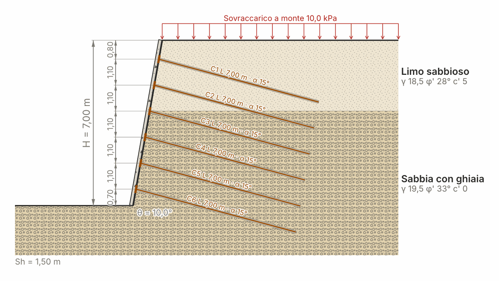
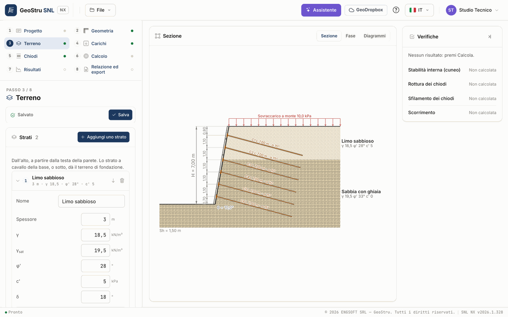
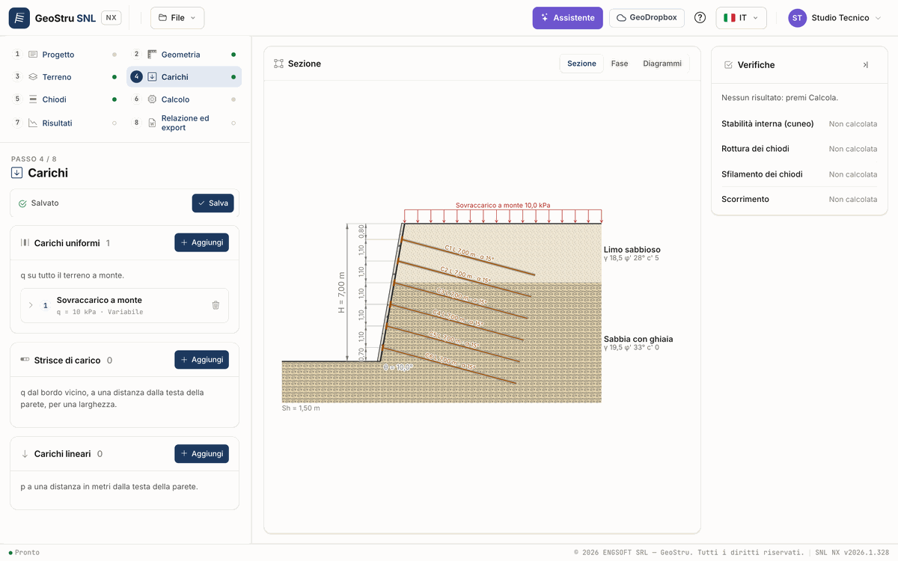
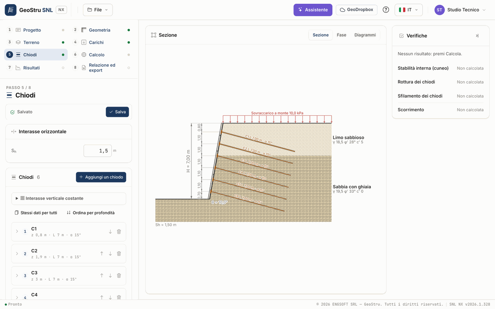
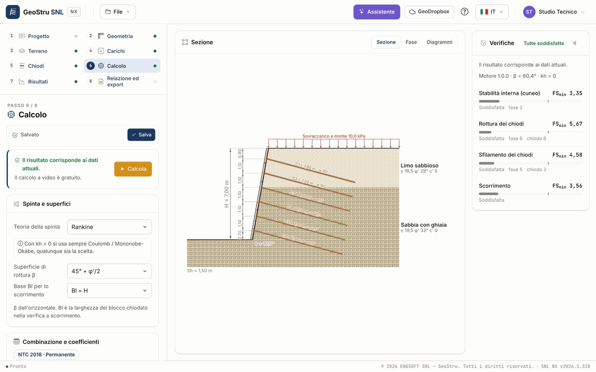
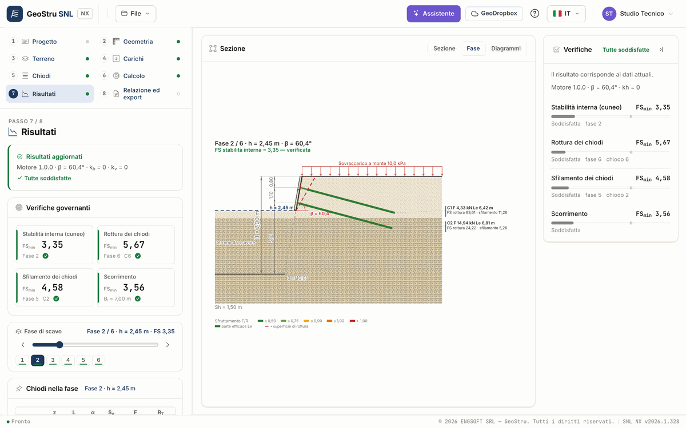
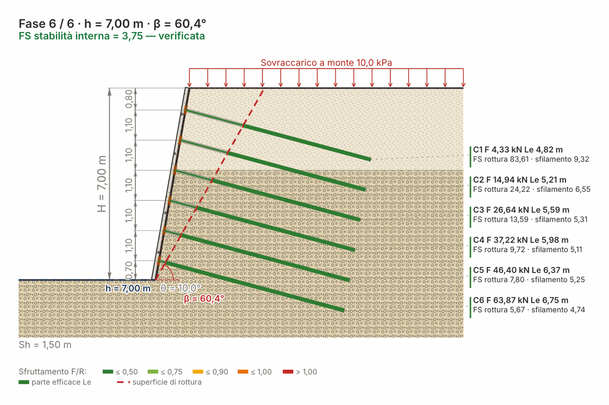
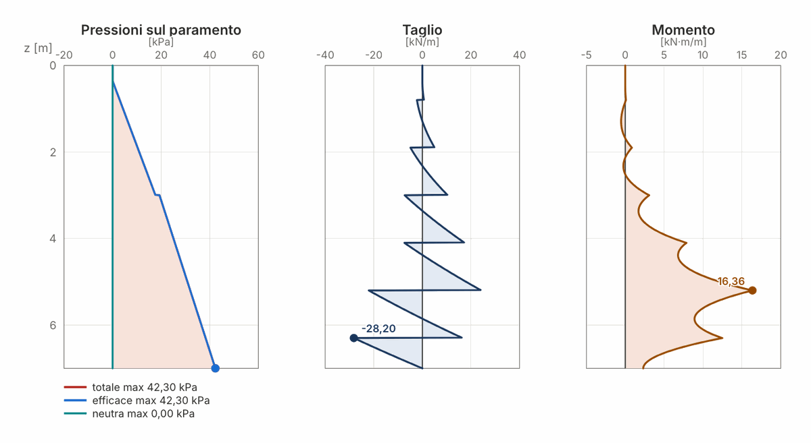
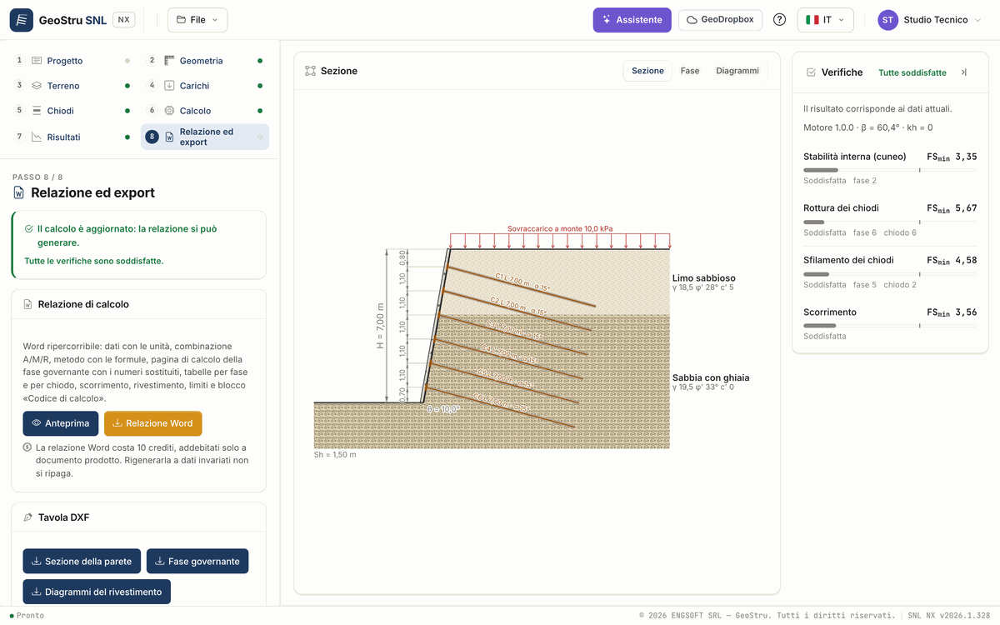

# Flusso di lavoro

SNL NX ha otto passi, elencati a sinistra. Ogni passo salva da sé ciò che scrivi; lo stato accanto al nome dice se è **Compilato**, **Da compilare** o **Da correggere**. Al centro il disegno della sezione si aggiorna a ogni modifica, a destra il pannello **Verifiche** riassume il calcolo.

Unità: metri, kN, kPa, kN/m³, gradi; fy in MPa. Le profondità si misurano **dalla testa della parete, verso il basso**. I diametri di barra e foro sono in **metri** (0,032 m, non 32).

## 1. Progetto

### Dati generali

**Nome dell'opera** (il titolo della relazione), **Descrizione**, **Committente**, **Cantiere**, **Progettista**, **Data**, **Indirizzo o località**. La sezione **Studio tecnico** (intestazione, indirizzo, contatti, partita IVA) compare nell'intestazione della relazione.

### Normativa e opera

- **Normativa**: **NTC 2018**, **Eurocodice 7** oppure **Utente (coefficienti liberi)**;
- **Opera**: **Permanente** o **Provvisoria**.

!!! warning "Coefficienti"
    Cambiare normativa o tipo di opera ricarica i coefficienti A, M, R e ξ del passo **Calcolo**: quelli scritti a mano si perdono.

### Posizione del sito

Cerca l'indirizzo con **Cerca**, fai clic sulla carta o trascina il segnaposto: **Latitudine** e **Longitudine** si aggiornano.

### Parametri sismici del sito

Imposta **Vita nominale VN**, **Classe d'uso**, **Categoria di sottosuolo** e **Categoria topografica**; il periodo di riferimento VR = VN·CU è calcolato. **Calcola dal sito** chiede ag, F0 e Tc* per ogni stato limite al servizio GeoStru Parametri Sismici; in alternativa scrivi i valori nella tabella e premi **Applica i valori della tabella**.

### Coefficienti sismici kh e kv

Sono i valori che il calcolo usa. Hai tre possibilità:

- **Proposta dal sito (SLV)**: dai parametri dello SLV l'app propone kh = βm·amax/g e kv = ±0,5·kh. βm vale 0,38 se non lo cambi. Scegli il **Segno di kv** e premi **Applica kh e kv proposti**. La proposta non entra nel calcolo finché non la applichi;
- **a mano**: scrivi kh e kv nei campi;
- **Senza sisma (kh = kv = 0)**.

Con kh > 0 la spinta si calcola sempre con Mononobe-Okabe, qualunque teoria sia scelta nel passo Calcolo.

### Rapporto di importazione

Se il progetto viene da un file `.snl`, in fondo al passo trovi il **Rapporto di importazione**. Vedi [Importazione](importazione.md).

## 2. Geometria

- **Altezza H** della parete [m];
- **Inclinazione θ del paramento** [°], misurata dal verticale, con la testa spostata verso monte;
- **Inclinazione ε del terreno a monte** [°]: il pendio a monte si considera indefinito.

La sezione **Solo disegno** (lunghezza del tratto a monte e a valle, inclinazione a valle, spessore del rivestimento) serve al disegno e al computo, non al calcolo.

## 3. Terreno

### Strati

Gli strati vanno **dall'alto**, a partire dalla testa della parete. Per ogni strato: **Nome**, **Spessore** [m], γ e γsat [kN/m³], φ' [°], c' [kPa], δ [°] e **K di interazione chiodo-terreno**, più una descrizione.

- δ è l'attrito parete-terreno (teoria di Coulomb) e chiodo-terreno (resistenza allo sfilamento);
- accanto a K trovi il valore **Proposto da φ'**: **Usa** lo copia nel campo. K = 0 vale 1 nel calcolo;
- lo strato a cavallo della base, o il primo sotto, è il **terreno di fondazione** della verifica a scorrimento. Lo spessore totale degli strati deve superare H.

Con le frecce sposti uno strato su o giù; il cestino lo elimina dopo una conferma.

### Falda

Attiva **Falda presente** e indica la **Profondità dalla testa della parete**. La falda è idrostatica: sotto la falda si usa γsat e si considera la spinta dell'acqua.

## 4. Carichi

Tre elenchi di carichi a monte, ciascuno con **Descrizione**, **Categoria** (Permanente, Variabile, Eccezionale) e **Coefficiente A**:

| Elenco | Dati |
|---|---|
| **Carichi uniformi** | q [kPa] su tutto il terreno a monte |
| **Strisce di carico** | q [kPa], **Distanza del bordo vicino** dalla testa della parete e **Larghezza** [m] |
| **Carichi lineari** | p [kN/m] e **Distanza dalla testa** [m] |

Il coefficiente A di ogni carico si scrive a mano: la categoria lo descrive, non lo imposta.

## 5. Chiodi

**Interasse orizzontale** Sh [m], unico per tutta la parete. Poi l'elenco dei chiodi, uno per riga:

| Campo | Unità | Note |
|---|---|---|
| **Nome** | | facoltativo |
| **Profondità della testa** | m | dalla testa della parete, verso il basso |
| **Lunghezza L** | m | |
| **Inclinazione α** | ° | sotto l'orizzontale |
| **Diametro del foro** | m | entra nella resistenza allo sfilamento |
| **Barra d'archivio** | | scegli una barra per copiarne diametro e fy |
| **Diametro della barra** | m | entra nella resistenza a trazione |
| fy | MPa | resistenza dell'acciaio |
| kn | | riduce la spinta sul chiodo; ≤ 0 vale 0,85 |

Comandi dell'elenco:

- **Interasse verticale costante**: indica **Profondità del primo chiodo**, **Interasse verticale** e **Numero di chiodi** e premi **Applica**. I chiodi esistenti tengono i loro dati e cambiano profondità; i nuovi copiano l'ultimo; quelli in più del numero si tolgono;
- **Stessi dati per tutti**: copia L, α, diametri, fy e kn del chiodo aperto (o del primo) su tutti gli altri;
- **Ordina per profondità**.

Il calcolo considera comunque i chiodi in ordine di profondità. Due chiodi alla stessa profondità o un chiodo sotto il piede della parete sono errori.

## 6. Calcolo

### Spinta e superfici

- **Teoria della spinta**: **Rankine** o **Coulomb**. Con kh > 0 si usa sempre Coulomb / Mononobe-Okabe;
- **Superficie di rottura β**: **45° + φ'/2** (con φ' medio della fase) o **Manuale** (β manuale, dall'orizzontale);
- **Base Bl per lo scorrimento**: **Bl = H**, **Manuale** (Bl manuale) o **Automatica** (dalla proiezione del primo chiodo). Bl è la larghezza del blocco chiodato nella verifica a scorrimento.

### Combinazione e coefficienti

Un **Nome della combinazione** e i coefficienti, caricati dalla normativa scelta nel passo Progetto e modificabili:

- ξ: fattore di correlazione sul numero di profili d'indagine, divide la resistenza allo sfilamento;
- **Coefficienti A (azioni)**: **A peso** e **A sisma** (il coefficiente A di ogni carico è nel passo Carichi);
- **Coefficienti M (terreno)**: γφ' (riduce tan φ'), γc', γδ;
- **Coefficienti R (resistenze)**: **R rottura dei chiodi**, **R sfilamento**, **R scorrimento**, **R verifiche interne**.

Vedi [Coefficienti parziali](teoria.md#coefficienti-parziali).

### Calcola

Premi **Calcola**. Il calcolo a video è gratuito. Sopra il pulsante leggi lo stato:

- «Il risultato corrisponde ai dati attuali»;
- «Il risultato non è aggiornato: i dati sono cambiati dopo il calcolo» — ricalcola;
- il motivo per cui il calcolo si è fermato (dati non validi, coefficiente di spinta non calcolabile, β non valida…).

Gli errori di validazione bloccano il calcolo; gli avvisi no.

## 7. Risultati

Il passo **Risultati** mostra il risultato dell'ultimo calcolo, se è aggiornato:

- **fasi di scavo**: per ogni fase la profondità di scavo, i parametri medi, il peso del cuneo W, i carichi Q, la spinta dell'acqua U, il contributo dei chiodi S e il fattore di sicurezza della verifica interna, con la fase governante in evidenza;
- **chiodi**: per ogni chiodo la zona d'influenza, la forza F, la resistenza a trazione RT e, fase per fase, la lunghezza efficace Le, la resistenza allo sfilamento e i fattori di sicurezza;
- **scorrimento**: base Bl, altezza H1, peso del blocco, spinte del terreno, dei carichi e dell'acqua, resistenza e fattore di sicurezza;
- **rivestimento**: diagrammi di pressione, taglio e momento lungo il paramento.

Sopra il disegno, le viste dei risultati mostrano la fase scelta con la superficie di rottura e i diagrammi. Un fattore di sicurezza infinito (chiodo scarico) si scrive «—».

Il pannello **Verifiche** a destra dà il minimo di ogni famiglia con la fase e il chiodo che governano. «Non aggiornata» vuol dire che hai cambiato un dato dopo il calcolo.

## 8. Relazione ed export

Con un calcolo aggiornato puoi scaricare:

- la **relazione Word**: dati, ipotesi, risultati per fase e per chiodo, scorrimento, diagrammi e il blocco «Codice di calcolo» con il codice documento verificabile su geostru.ai;
- la **tavola DXF** della sezione, firmata.

Ognuna consuma 10 crediti; un documento non prodotto non si paga. Vedi [Crediti](crediti.md) e [Formati](formati.md).

---

*Hai trovato un errore in questa pagina? [Segnalacelo](mailto:info@geostru.ai) o apri una [Pull Request](https://github.com/EngSoft-Geostru/geostru-help-nx/edit/main/snl/docs/it/workflow.md).*
