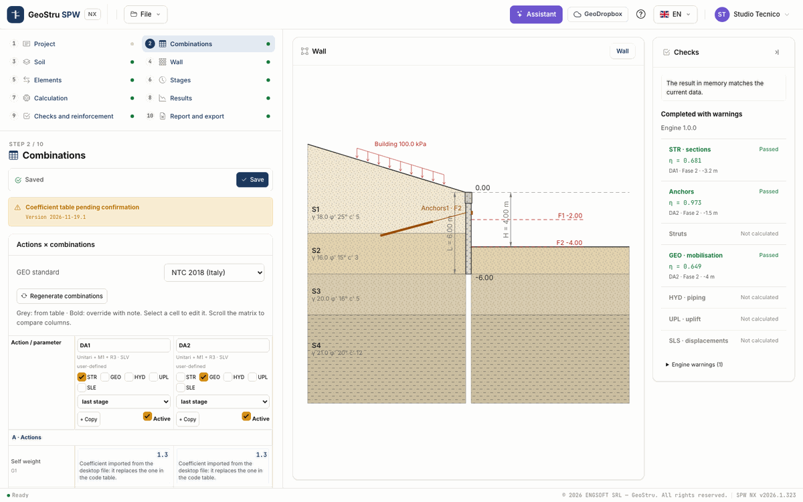

# Combinations

Combinations define how actions, ground parameters and resistances enter the checks. In SPW NX they belong to the project, rather than being different copies inside each stage.

## Why they come before stages

Each combination follows the construction sequence. Its scope can include every stage, only the last one or a selected list.

This arrangement preserves the site history. Even when you check only the last stage, the model retains the events through which it was reached.

The seismic combination can add seismic action to the final condition. Seismic coefficients derive from the site and limit state, not from a value written in a single stage.

## The matrix

The **Actions × combinations** table places combinations on the columns and actions or parameters on the rows.

| Group | What it controls |
|---|---|
| A · Actions | self-weight, earth pressure, water, seismic action, loads and their categories |
| M · Ground parameters | ground strength and weight according to the selected approach |
| R · Resistances | passive resistance, anchors and other expected resistances |

Self-weight, earth pressure and water share the structural permanent action entry. Loads inherit factors and combination factors from their G1, G2 or Q category. Seismic action enters only seismic combinations.

Preload belongs to the anchor or its installation event. It is not a matrix factor.

## Legend and exceptions

- **Grey**: value generated from the code table.
- **Bold**: user-assigned value, also called an override.

Select a cell to change the factor. Always enter the **Reason for the override**. Then choose **Apply and save**.

**Restore from table** removes the selected exception. If there is an exception on the category and one on the individual load, restoring the load leaves the category exception.

!!! warning "Warning"
    An exception changes the verification. Document its reason in the project context and check the effects on every stage in the scope.

## Name, type and scope

In each combination column you can check:

- name;
- STR, GEO, HYD, UPL and SLE verification types;
- stages checked;
- active or disabled status.

**Copy** creates a derived combination. Give it a different name and check its scope. A disabled combination enters neither calculation nor envelopes.

## Regenerating combinations

**Regenerate combinations** applies the selected code. The program asks for confirmation because the change affects the whole project.

User-created combinations and exceptions remain. The scopes of generated combinations return to their expected rules. Always check the matrix after regeneration.

When finished use **Save combinations**. The status confirms that the data are in the project.

## Factor table to be confirmed

The yellow strip reports that the factor table awaits confirmation. Do not overlook this warning when assessing the project.

Before calculation:

1. compare the factors with the code and selected approach;
2. check favourable and unfavourable actions;
3. check groups M and R;
4. check the scopes of seismic and hydraulic combinations;
5. document every exception with a note that remains readable in the report.

For code references see [Methods](metodi.md) and [Validation](validazione.md).

---

*Found an error on this page? [Let us know](mailto:info@geostru.ai) or open a [Pull Request](https://github.com/EngSoft-Geostru/geostru-help-nx/edit/main/spw/docs/en/combinazioni.md).*
