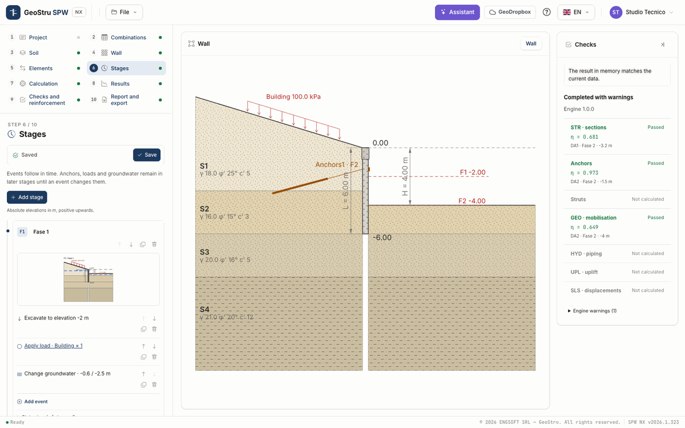

# Construction stages

Stages describe what happens over time. Each stage contains a list of events. The end-of-stage state derives from previous events and those just entered.

## Adding and ordering

Use **Add stage** to extend the sequence. For each stage you can change its name, add events, duplicate it, move it or delete it.

Thumbnails show excavation, groundwater, supports and loads at the end of the stage. **End-of-stage state** summarises the configuration calculated from the events.

!!! warning "Warning"
    Moving or deleting a stage changes the state of later stages. Check the sequence after these operations.

## Elevations and references

Elevations are absolute, in metres, positive upwards. They are not depths from the wall head. Excavations and backfilling indicate the final elevation on the excavation side.

Anchors, struts and loads come from the **Elements** step. If an element is missing, define it there first. Then refer to it with an event.

## Available events

| Event | When to use it |
|---|---|
| Excavate to elevation | lower the excavation surface to the stated elevation |
| Backfill to elevation | restore ground on the excavation side up to the stated elevation |
| Install anchor | activate an anchor; you can assign preload |
| Prestress anchor | change the preload of an installed anchor |
| Remove anchor | deactivate the anchor from that stage |
| Install strut | activate a strut |
| Remove strut | deactivate the strut from that stage |
| Apply load | activate a load with the stated application factor |
| Remove load | deactivate the load from that stage |
| Change water table | update groundwater elevations and regime |
| Remove water table | remove groundwater from the stage model |
| Head restraint | assign or change displacement, rotation or spring |
| Assigned pressures | define an additional or replacement diagram |

The load application factor scales the value entered in the event. The combination factor still comes from the load category.

## What persists into later stages

Anchors, struts, loads and groundwater remain until an event changes or removes them. Do not repeat installation to keep them active.

A stage without events continues the previous state. This is useful when you want to check a condition without adding work.

## Active and passive anchors

An active anchor receives preload. You can assign it in the definition or installation event. The **Prestress anchor** event changes it later.

A passive anchor has no initial preload. It enters the sequence when installed and responds to subsequent changes in the model.

## Water table

**Change water table** updates elevations on both sides and the hydrostatic or seepage regime. **Remove water table** removes it from later stages.

The initial water table is defined in the **Ground** step. Events change it only from their position in the sequence.

## Restraints and assigned pressures

Reuse the same restraint identifier when changing or releasing it. The **Free** condition removes it. The value takes the unit shown next to the field.

The pressure diagram replaces the previous assigned diagram. For each segment choose whether to add the pressures to earth pressures or replace them. An empty diagram removes assigned pressures.

## Checks before calculation

1. Check the chronological order of events.
2. Check that every support is installed before prestressing or removal.
3. Check excavation and groundwater elevations.
4. Read the anomalies highlighted in the stage and previous stages.
5. Make sure that combinations include the stages you want to verify.

---

*Found an error on this page? [Let us know](mailto:info@geostru.ai) or open a [Pull Request](https://github.com/EngSoft-Geostru/geostru-help-nx/edit/main/spw/docs/en/fasi.md).*
