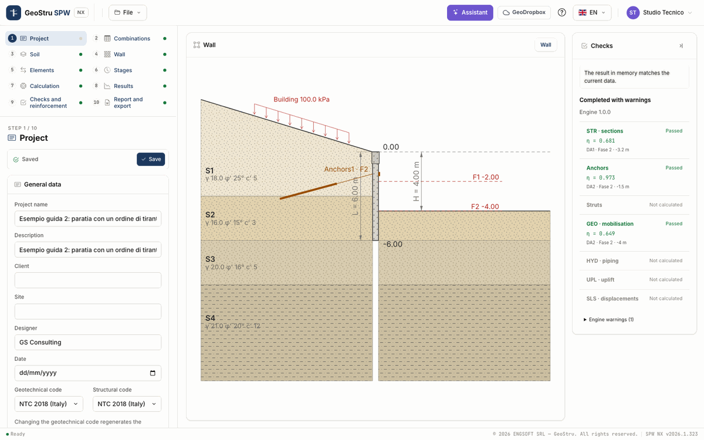
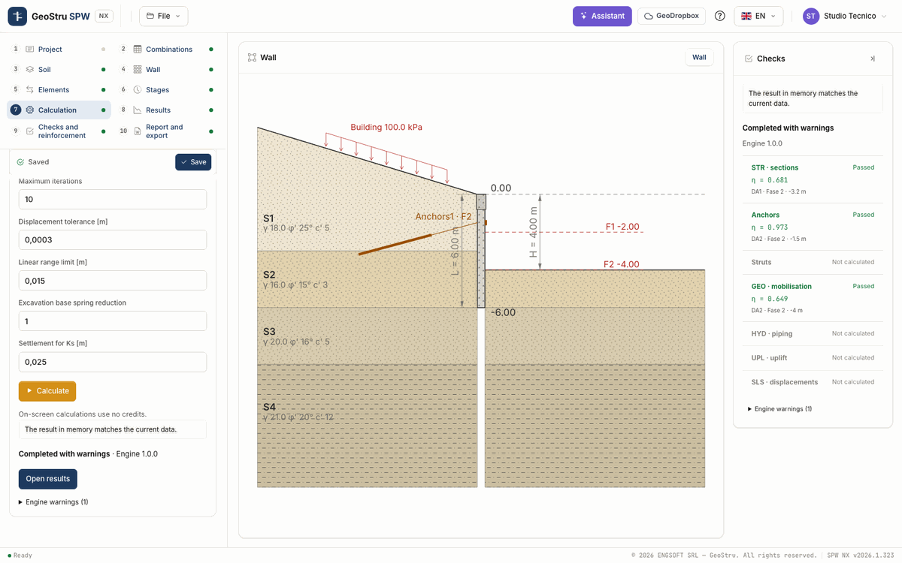
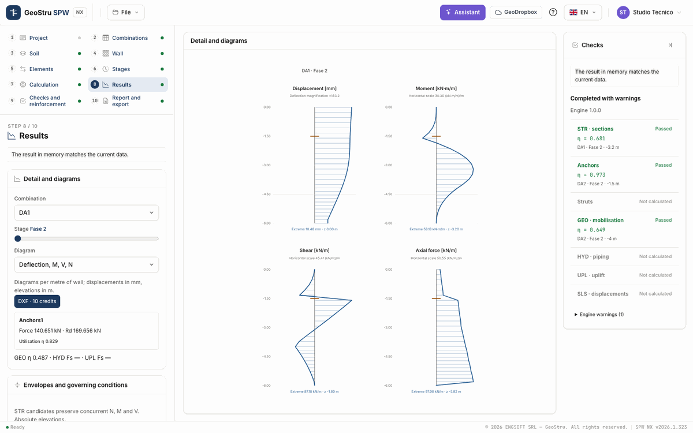
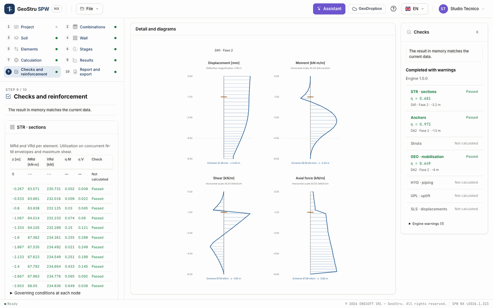
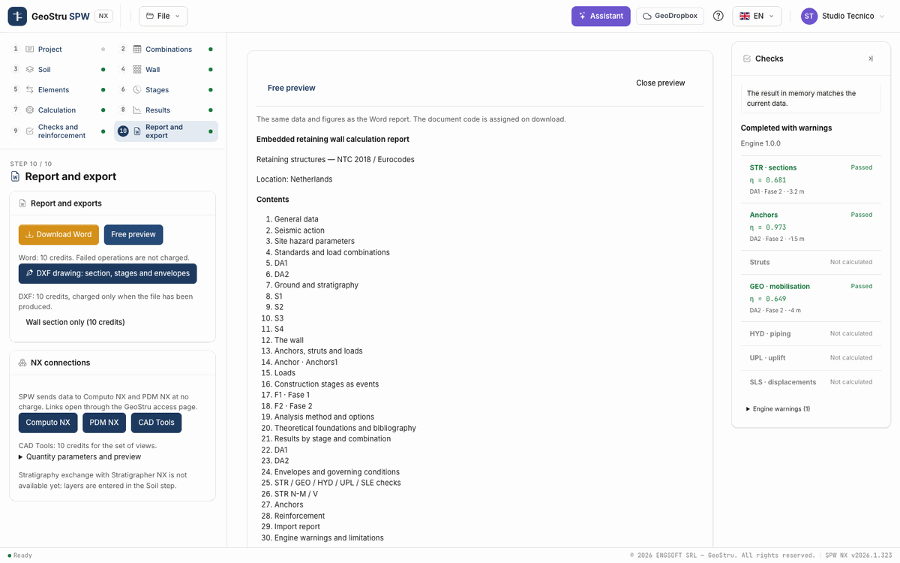

# Quick start (5 minutes)

Use the **Schema_2** example: a pile wall with one anchor, two excavation stages, loads and seismic action. It is a desktop program file. When opened, SPW NX converts it to the native model and shows the import report.

## 1. Open the example

Open [SPW NX](https://nx.geostru.ai/spw/). In the **File** menu choose **Schema_2** from the examples list.

If the current project has unsaved changes, the program asks whether you want to keep them. The example replaces the project on screen.

The **Project** step shows the general data. At the bottom you find the **Import report**: read the “Not imported” and “Assumed” entries before using the model.

## 2. Check the model

Scroll through the steps in order:

1. **Combinations**: check the imported combinations and the “Factor table to be confirmed” strip.
2. **Ground**: check the ground surface, layers and water table. One stratigraphy is used for every stage.
3. **Wall**: check type, length, embedment and materials.
4. **Elements**: check the anchor and loads. Every element has a stable identifier.
5. **Stages**: read the events in order. The anchor enters in its installation stage.

The central drawing helps you check elevations, layers, excavations, groundwater, supports and loads. Details are in the [Workflow](workflow.md).

## 3. Calculate

Open **Calculation**. The example uses **FEM**. Check the options and press **Calculate**.

On-screen calculation is free. The progress bar shows completed combinations. When finished, read the outcome and the **Engine warnings**.

You can also try **LEM**: choose the method in the first drop-down, save and press **Calculate** again. LEM does not return displacements: the deflection diagram shows “Data unavailable”.

## 4. View the results

Open **Results**.

- Choose **Combination**, **Stage** and **Diagram**.
- Read displacement, bending moment, shear and axial force per metre of wall.
- Check support forces and geotechnical and hydraulic indicators.
- Scroll to **Envelopes and governing conditions**. Each extreme reports combination, stage and elevation.
- Open **STR: all nodes and concomitant values** to see moment, shear and axial force from the same condition.

The deflected shape is amplified for readability. Its scale is written above the diagram.

## 5. Check verifications and reinforcement

Open **Checks and reinforcement**. Check the outcomes for sections, anchors and struts. Also read checks marked as not calculated: they do not mean a positive outcome.

The **Final reinforcement** section summarises bars and ties. **Preliminary reinforcement by node** shows the demand along the wall.

## 6. Report and export

Open **Report and export**.

1. Press **Free preview**: the report appears in the centre with contents, tables and figures. It is the same report as the Word file, without the document code.
2. Press **Download Word** for the `.docx` file (10 credits). The button is active only with a complete and up-to-date calculation.
3. Press **DXF drawing: section, stages and envelopes** for the full drawing, or **Wall section only** (10 credits each).

On the same page, **NX connections** opens Computo NX, PDM NX and CAD Tools with the wall data. The DXF of the diagram on screen is also available from **DXF · 10 credits** in the Results step. See [Credits](crediti.md).

## 7. Save the project

Use **File → Save as…** to download a `.spwnx`. The file keeps the inputs and import report. Results are recalculated after opening.

You can also save the project to **GeoDropbox**. Do not leave your only copy in the session: it expires after 30 minutes of inactivity.

---

*Found an error on this page? [Let us know](mailto:info@geostru.ai) or open a [Pull Request](https://github.com/EngSoft-Geostru/geostru-help-nx/edit/main/spw/docs/en/quickstart.md).*
