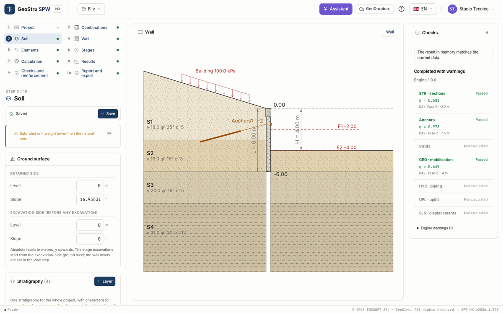
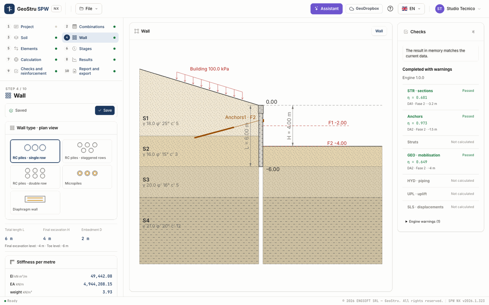
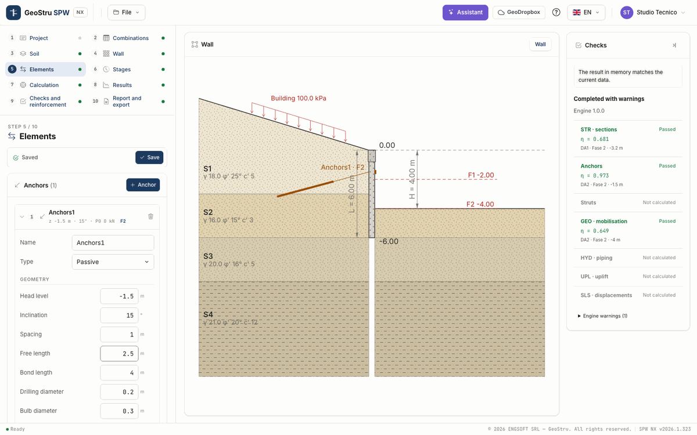

# Workflow

A project follows ten steps. Upstream data feed downstream steps. If you change an input after calculation, the result becomes **out of date**: calculate again before using it.

## 0. New, example or existing file

From the **File** menu you can:

- create a project with **New**;
- open a `.spwnx` with **Open…**;
- import a desktop `.spwx`;
- open one of the examples;
- save with **Save** or **Save as…**.

The project remains in the session for 30 minutes of inactivity. Save it to a file or GeoDropbox.

## 1. Project and site

Enter name, description, client, site, designer and date. Studio data are used for the report heading.

Choose the **Geotechnical code** and **Structural code**. Changing the geotechnical code regenerates the expected combinations and asks for confirmation.

For the site:

1. search for the location or click the map;
2. check latitude, longitude and altitude;
3. enable or disable seismic action;
4. with seismic action enabled, choose nominal life, use class, subsoil category and topographic category;
5. enter the wall's **allowable displacement**;
6. request the site parameters or apply values entered by you.

The table reports return periods and hazard parameters for the limit states. Check the stated source.

If you arrive from **Atlante NX**, the site position comes with the link. A project without a position receives it at once. If the project already has a different position, the **Report and export** step asks whether to replace it. After replacing it, request the site parameters again.

## 2. Combinations before stages

Define combinations before describing construction. Each combination applies to the stage sequence. The same safety rule therefore follows the whole project.

In the **Actions × combinations** matrix you check:

- activation and verification type;
- stages included in the scope;
- factors on actions;
- factors on ground parameters;
- factors on resistances.

Grey cells come from the table. Bold cells are exceptions with a reason. The **Factor table to be confirmed** strip reminds you that the designer must verify the code table.

See [Combinations](combinazioni.md).

## 3. Ground with one stratigraphy

Set ground elevation and slope on the retained and excavation sides. Elevations are absolute, in metres, positive upwards. Stage excavations start from the excavation-side ground surface.

Add layers from top to bottom. For each layer enter:

- name, thickness and drained or undrained behaviour;
- natural and saturated unit weight;
- characteristic strength and soil-wall friction;
- overconsolidation ratio;
- subgrade reaction modulus for FEM and related data;
- oedometric data, permeability, inclination and colour among the other data.

One stratigraphy is used throughout the project. Stages do not hold different copies.

Enable the initial water table if present. Enter elevations on both sides, regime and the piping check.

## 4. Wall with one type

Choose one type for the full height:

- single-row RC piles;
- staggered RC piles;
- double-row RC piles;
- micropiles;
- diaphragm.

Enter head elevation, length and longitudinal extent. Fill in the geometry, spacing, materials and reinforcement required by the selected type. You can add the capping beam.

The summary shows total length, final excavation and embedment. Stiffness and weight are referred to one metre of wall.

## 5. Elements with identifier and category

Define anchors, struts and loads once. Refer to them in the stages through their identifier. A definition does not make them active: an event is required in the sequence.

- **Anchors**: position, inclination, spacing, lengths, bulb, reinforcement, active or passive type, preload, duration and resistance.
- **Struts**: position, geometry, material and assigned or proposed stiffness.
- **Loads**: G1, G2 or Q category, variable action type, favourable or unfavourable sign, geometry and characteristic value.

The category determines the factors in the matrix. Do not enter a factor in the individual load.

## 6. Stages as events

Each stage contains ordered events. You can excavate, backfill, install or remove supports, prestress an anchor, apply or remove a load, change groundwater, assign restraints and pressures.

The state continues into later stages until an event changes it. Do not copy an active anchor: enter only what happens in that stage.

Thumbnails show the state at the end of the stage. See [Stages](fasi.md).

## 7. LEM or FEM calculation

Choose the method and the theories for active, passive and seismic earth pressure. For FEM set linear or nonlinear analysis, discretisation, convergence and ground response limits.

Press **Calculate**. The program follows the stages for every active combination. An incomplete combination is excluded from the envelopes and reported.

With **LEM** the FEM options stay collapsed and are not used. LEM returns internal forces, design embedment and support forces, but not displacements.

The meaning of the methods is in [Methods](metodi.md).

## 8. Results and envelopes

In the detail view choose combination, stage and diagram. Deflected shape, moment, shear, axial force, pressures, subgrade reaction and passive mobilisation are available when relevant.

Envelopes find the extremes among the calculated conditions. The **Combination · stage · elevation** column states where each value comes from.

For structural checks, concomitant values stay together. Do not combine a maximum moment with an axial force from another condition.

## 9. Checks and reinforcement

Check:

- section bending and shear resistance;
- anchor utilisation for pull-out and steel resistance;
- strut resistance;
- passive mobilisation;
- piping and uplift when requested;
- displacements against the project limit.

Read warnings and entries marked **Not calculated**. Strut buckling, global stability, vertical bearing capacity and section SLE checks are not available.

## 10. Report, DXF and links

The **Report and export** step collects the project outputs. Commands become active with a complete and up-to-date calculation.

- **Free preview** shows the report in the centre with contents, tables and figures. The document code is assigned only on download.
- **Download Word** produces the `.docx` report: general data, site, combinations with their exceptions, ground, wall, elements, stages, method, results, envelopes, checks, reinforcement, import report, engine warnings and the “Calculation software” block.
- **DXF drawing: section, stages and envelopes** produces the full drawing; **Wall section only** the section drawing alone.

Word and DXF cost 10 credits each and are charged only when the file is produced. The DXF of the diagram on screen can also be requested from the Results step.

**NX connections**

- **Computo NX** receives the wall items. Open **Quantity parameters and preview** to set wall length in plan, steel laps and wastage and price list region, update quantities and untick the items you do not want to transfer.
- **PDM NX** receives the description of the structure for the maintenance plan.
- **CAD Tools** receives the wall views for editing (10 credits for the set of views).

The target app opens in a new tab through the GeoStru single access page. Computo NX and PDM NX are not charged by SPW. Stratigraphy exchange with Stratigrapher NX is not available: layers are entered in the Soil step.

---

*Found an error on this page? [Let us know](mailto:info@geostru.ai) or open a [Pull Request](https://github.com/EngSoft-Geostru/geostru-help-nx/edit/main/spw/docs/en/workflow.md).*
