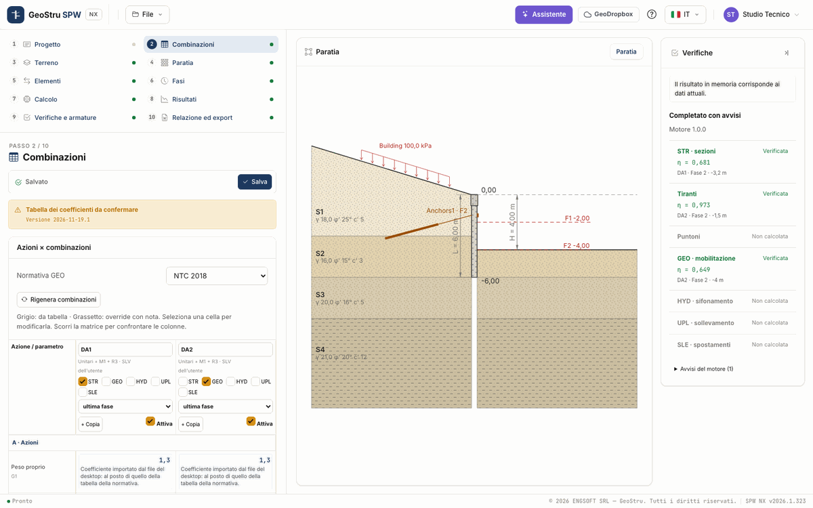

# Combinazioni

Le combinazioni definiscono come azioni, parametri del terreno e resistenze entrano nelle verifiche. In SPW NX sono dati del progetto, non copie diverse dentro ogni fase.

## Perché vengono prima delle fasi

Ogni combinazione attraversa la sequenza costruttiva. Il suo ambito può comprendere tutte le fasi, solo l'ultima oppure un elenco scelto.

Questa impostazione mantiene la storia del cantiere. Anche quando verifichi solo l'ultima fase, il modello conserva gli eventi con cui l'hai raggiunta.

La combinazione sismica può aggiungere l'azione sismica alla condizione finale. I coefficienti sismici derivano dal sito e dallo stato limite, non da un valore scritto in una singola fase.

## La matrice

La tabella **Azioni × combinazioni** mette le combinazioni sulle colonne e le azioni o i parametri sulle righe.

| Gruppo | Cosa controlla |
|---|---|
| A · Azioni | peso proprio, spinta, acqua, sisma, carichi e loro categorie |
| M · Parametri del terreno | resistenza e peso del terreno secondo l'approccio scelto |
| R · Resistenze | resistenza passiva, ancoraggi e altre resistenze previste |

Peso proprio, spinta del terreno e acqua condividono la voce dell'azione permanente strutturale. I carichi ereditano coefficienti e fattori di combinazione dalla categoria G1, G2 o Q. Il sisma entra solo nelle combinazioni sismiche.

Il precarico appartiene al tirante o al suo evento di installazione. Non è un coefficiente della matrice.

## Legenda ed eccezioni

- **Grigio**: valore generato dalla tabella della normativa.
- **Grassetto**: valore imposto dall'utente, detto anche override.

Seleziona una cella per modificare il coefficiente. Scrivi sempre la **Motivazione dell'override**. Poi scegli **Applica e salva**.

**Ripristina da tabella** elimina l'eccezione selezionata. Se esiste un'eccezione sulla categoria e una sul singolo carico, il ripristino del carico lascia quella della categoria.

!!! warning "Attenzione"
    Un'eccezione cambia la verifica. Motivala nel contesto del progetto e controlla gli effetti su tutte le fasi comprese nell'ambito.

## Nome, tipo e ambito

Nella colonna di ogni combinazione puoi controllare:

- il nome;
- i tipi di verifica STR, GEO, HYD, UPL e SLE;
- le fasi verificate;
- lo stato attivo o disattivato.

**Copia** crea una combinazione derivata. Dagli un nome diverso e controlla il suo ambito. Una combinazione disattivata non entra nel calcolo né negli inviluppi.

## Rigenerare le combinazioni

**Rigenera combinazioni** applica la normativa scelta. Il programma chiede conferma perché la modifica vale per l'intero progetto.

Le combinazioni create dall'utente e le eccezioni restano. Gli ambiti delle combinazioni generate tornano alle regole previste. Controlla comunque la matrice dopo la rigenerazione.

Al termine usa **Salva combinazioni**. Lo stato conferma che i dati sono nel progetto.

## Tabella dei coefficienti da confermare

La striscia gialla segnala che la tabella dei coefficienti attende conferma. Non nascondere questo avviso quando valuti il progetto.

Prima del calcolo:

1. confronta i coefficienti con la normativa e con l'approccio scelto;
2. controlla le azioni favorevoli e sfavorevoli;
3. controlla i gruppi M e R;
4. verifica gli ambiti delle combinazioni sismiche e idrauliche;
5. documenta ogni eccezione con una nota leggibile nella relazione.

Per i riferimenti normativi vedi [Metodi](metodi.md) e [Validazione](validazione.md).

---

*Hai trovato un errore in questa pagina? [Segnalacelo](mailto:info@geostru.ai) o apri una [Pull Request](https://github.com/EngSoft-Geostru/geostru-help-nx/edit/main/spw/docs/it/combinazioni.md).*
