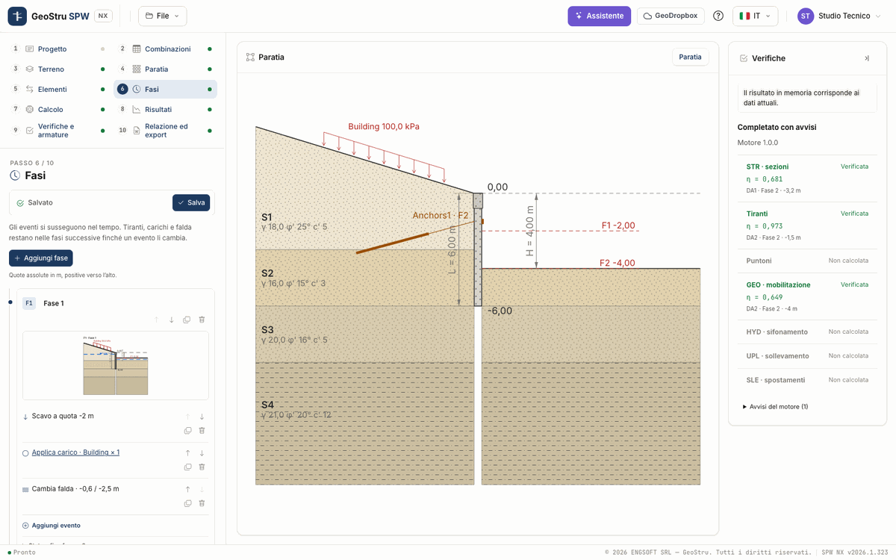

# Fasi costruttive

Le fasi descrivono ciò che accade nel tempo. Ogni fase contiene un elenco di eventi. Lo stato a fine fase deriva dagli eventi precedenti e da quelli appena inseriti.

## Aggiungere e ordinare

Usa **Aggiungi fase** per estendere la sequenza. Per ogni fase puoi cambiare il nome, aggiungere eventi, duplicarla, spostarla o eliminarla.

Le miniature mostrano scavo, falda, supporti e carichi presenti a fine fase. **Stato a fine fase** riassume la configurazione calcolata dagli eventi.

!!! warning "Attenzione"
    Spostare o eliminare una fase cambia lo stato delle fasi successive. Controlla la sequenza dopo queste operazioni.

## Quote e riferimenti

Le quote sono assolute, in metri, positive verso l'alto. Non sono profondità dalla testa. Gli scavi e i rinterri indicano la quota finale a valle.

Tiranti, puntoni e carichi vengono dal passo **Elementi**. Se un elemento manca, definiscilo prima lì. Poi richiamalo con un evento.

## Eventi disponibili

| Evento | Quando lo usi |
|---|---|
| Scavo a quota | abbassi il piano di scavo a valle |
| Rinterro a quota | ripristini terreno a valle fino alla quota indicata |
| Installa tirante | attivi un tirante; puoi assegnare il precarico |
| Tesa tirante | cambi il precarico di un tirante già installato |
| Rimuovi tirante | disattivi il tirante da quella fase |
| Installa puntone | attivi un puntone |
| Rimuovi puntone | disattivi il puntone da quella fase |
| Applica carico | attivi un carico con il fattore di applicazione indicato |
| Rimuovi carico | disattivi il carico da quella fase |
| Cambia falda | aggiorni quote e regime della falda |
| Rimuovi falda | togli la falda dal modello della fase |
| Vincolo in testa | assegni o modifichi spostamento, rotazione o molla |
| Pressioni assegnate | definisci un diagramma aggiuntivo o sostitutivo |

Il fattore di applicazione del carico scala il valore inserito nell'evento. Il coefficiente di combinazione resta quello della categoria del carico.

## Cosa resta nelle fasi successive

Tiranti, puntoni, carichi e falda restano finché un evento li cambia o li rimuove. Non ripetere l'installazione per tenerli attivi.

Una fase senza eventi continua lo stato precedente. Questo è utile quando vuoi verificare una condizione senza aggiungere lavori.

## Tiranti attivi e passivi

Un tirante attivo riceve un precarico. Puoi assegnarlo nella definizione oppure nell'evento di installazione. L'evento **Tesa tirante** lo modifica in seguito.

Un tirante passivo non riceve il precarico iniziale. Entra nella sequenza quando viene installato e risponde ai cambiamenti successivi del modello.

## Falda

**Cambia falda** aggiorna le quote a monte e a valle e il regime idrostatico o di filtrazione. **Rimuovi falda** la elimina dalle fasi successive.

La falda iniziale si definisce nel passo **Terreno**. Gli eventi la modificano solo dal punto della sequenza in cui compaiono.

## Vincoli e pressioni assegnate

Per un vincolo riusa lo stesso identificativo quando vuoi cambiarlo o liberarlo. La condizione **Libero** lo rimuove. Il valore assume l'unità mostrata accanto al campo.

Il diagramma delle pressioni sostituisce il diagramma assegnato precedente. Per ogni tratto scegli se sommare le pressioni alle spinte oppure sostituirle. Un diagramma vuoto rimuove le pressioni assegnate.

## Controlli prima del calcolo

1. Verifica l'ordine temporale degli eventi.
2. Controlla che ogni supporto sia installato prima di una tesatura o rimozione.
3. Controlla le quote di scavo e di falda.
4. Leggi le anomalie evidenziate nella fase e nelle fasi precedenti.
5. Assicurati che le combinazioni comprendano le fasi che vuoi verificare.

---

*Hai trovato un errore in questa pagina? [Segnalacelo](mailto:info@geostru.ai) o apri una [Pull Request](https://github.com/EngSoft-Geostru/geostru-help-nx/edit/main/spw/docs/it/fasi.md).*
