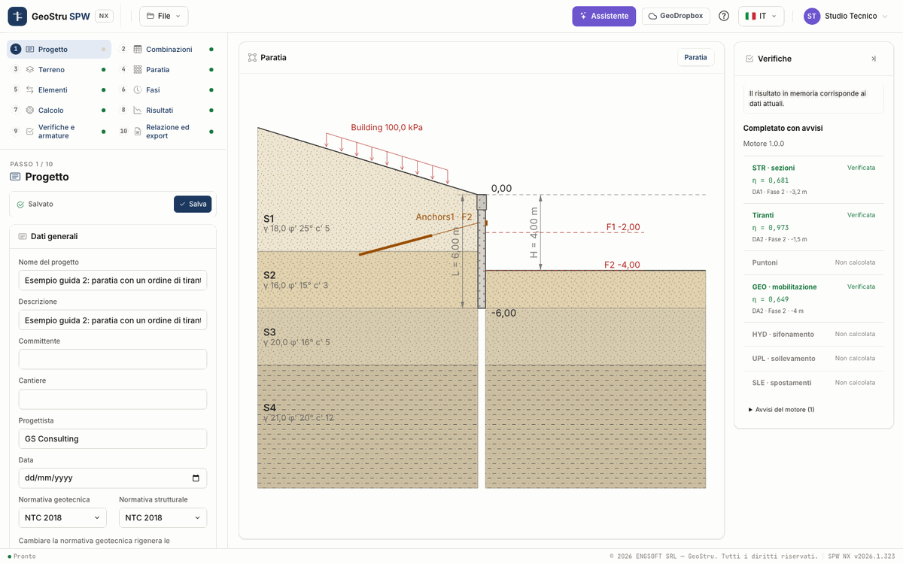
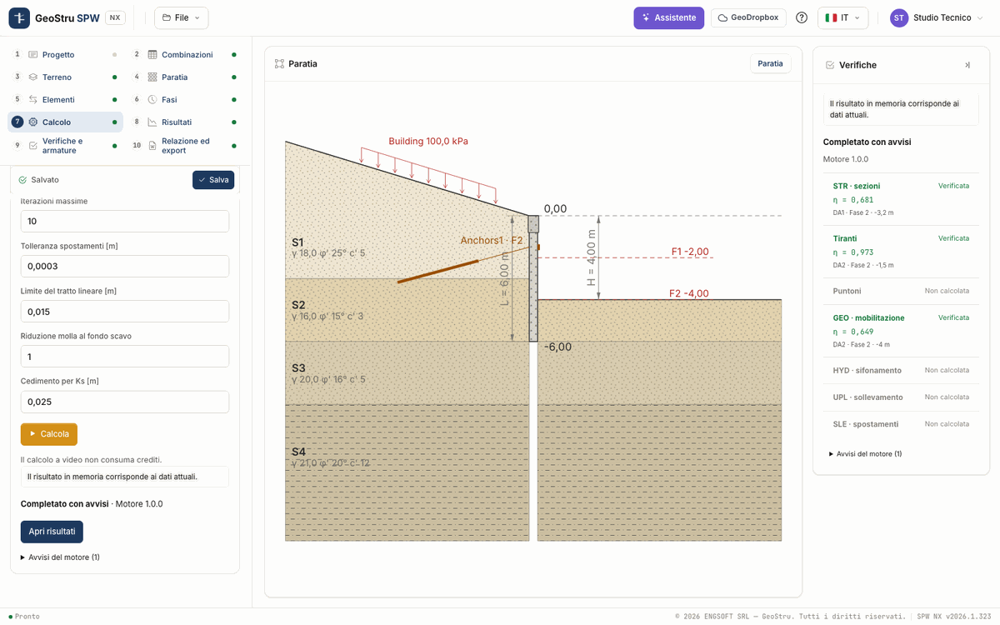
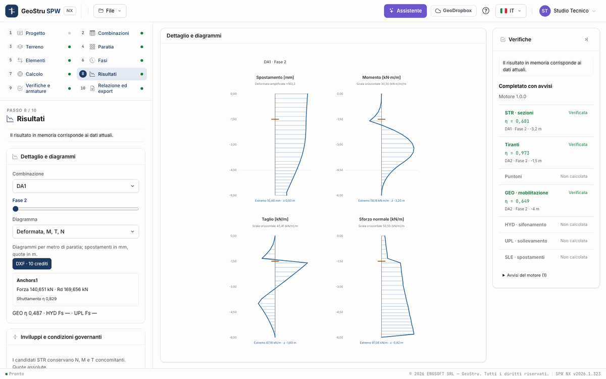
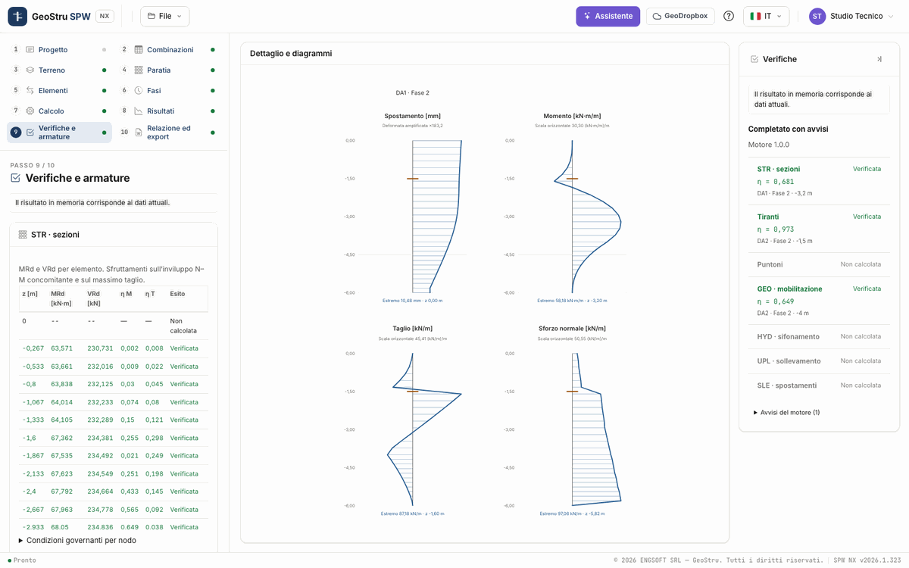
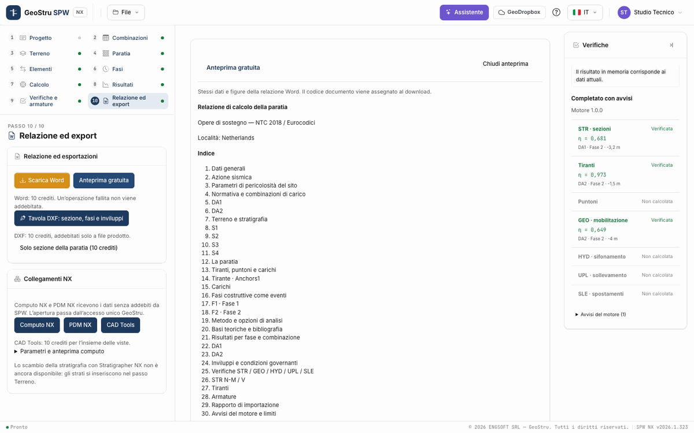

# Guida rapida (5 minuti)

Usa l'esempio **Schema_2**: una paratia di pali con un tirante, due fasi di scavo, carichi e sisma. È un file del programma desktop. All'apertura SPW NX lo converte nel modello nativo e mostra il rapporto di importazione.

## 1. Apri l'esempio

Apri [SPW NX](https://nx.geostru.ai/spw/). Nel menu **File** scegli **Schema_2** dall'elenco degli esempi.

Se il progetto corrente ha modifiche non salvate, il programma chiede se vuoi conservarle. L'esempio sostituisce il progetto a video.

Il passo **Progetto** mostra i dati generali. In fondo trovi il **Rapporto di importazione**: leggi le voci «Non importato» e «Assunto» prima di usare il modello.

## 2. Controlla il modello

Scorri i passi nell'ordine:

1. **Combinazioni**: controlla le combinazioni importate e la striscia «Tabella dei coefficienti da confermare».
2. **Terreno**: controlla piano campagna, strati e falda. La stratigrafia è unica per tutte le fasi.
3. **Paratia**: verifica tipologia, lunghezza, infissione e materiali.
4. **Elementi**: controlla il tirante e i carichi. Ogni elemento ha un identificativo stabile.
5. **Fasi**: leggi gli eventi nell'ordine. Il tirante entra nella fase in cui è installato.

Il disegno al centro aiuta a controllare quote, strati, scavi, falda, supporti e carichi. I dettagli sono nel [Flusso di lavoro](workflow.md).

## 3. Calcola

Apri **Calcolo**. Nell'esempio il metodo è **FEM**. Controlla le opzioni e premi **Calcola**.

Il calcolo a video è gratuito. La barra di avanzamento mostra le combinazioni completate. Al termine leggi l'esito e gli **Avvisi del motore**.

Puoi provare anche il **LEM**: scegli il metodo nella prima tendina, salva e premi di nuovo **Calcola**. Il LEM non restituisce gli spostamenti: il diagramma della deformata indica «Dato non disponibile».

## 4. Guarda i risultati

Apri **Risultati**.

- Scegli **Combinazione**, **Fase** e **Diagramma**.
- Leggi spostamento, momento, taglio e sforzo normale per metro di paratia.
- Controlla la forza nei supporti e gli indicatori geotecnici e idraulici.
- Scorri fino a **Inviluppi e condizioni governanti**. Per ogni estremo trovi combinazione, fase e quota.
- Apri **STR: tutti i nodi e i concomitanti** per vedere momento, taglio e sforzo normale della stessa condizione.

La deformata è amplificata per renderla leggibile. La scala è scritta sopra il diagramma.

## 5. Controlla verifiche e armature

Apri **Verifiche e armature**. Controlla gli esiti delle sezioni, dei tiranti e dei puntoni. Leggi anche le verifiche non calcolate: non equivalgono a un esito positivo.

La sezione **Armatura esecutiva** riassume barre e staffe. **Armature di semiprogetto per nodo** mostra la richiesta lungo la paratia.

## 6. Relazione ed export

Apri **Relazione ed export**.

1. Premi **Anteprima gratuita**: al centro compare la relazione con indice, tabelle e figure. È la stessa relazione del Word, senza il codice documento.
2. Premi **Scarica Word** per il file `.docx` (10 crediti). Il pulsante è attivo solo con un calcolo completo e aggiornato.
3. Premi **Tavola DXF: sezione, fasi e inviluppi** per la tavola completa, oppure **Solo sezione della paratia** (10 crediti ciascuna).

Nella stessa pagina, **Collegamenti NX** apre Computo NX, PDM NX e CAD Tools con i dati della paratia. Il DXF del diagramma a video è disponibile anche dal pulsante **DXF · 10 crediti** nel passo Risultati. Vedi [Crediti](crediti.md).

## 7. Salva il progetto

Usa **File → Salva con nome…** per scaricare un `.spwnx`. Il file conserva gli ingressi e il rapporto di importazione. I risultati si ricalcolano dopo l'apertura.

Puoi salvare il progetto anche su **GeoDropbox**. Non lasciare l'unico lavoro nella sessione: scade dopo 30 minuti di inattività.

---

*Hai trovato un errore in questa pagina? [Segnalacelo](mailto:info@geostru.ai) o apri una [Pull Request](https://github.com/EngSoft-Geostru/geostru-help-nx/edit/main/spw/docs/it/quickstart.md).*
