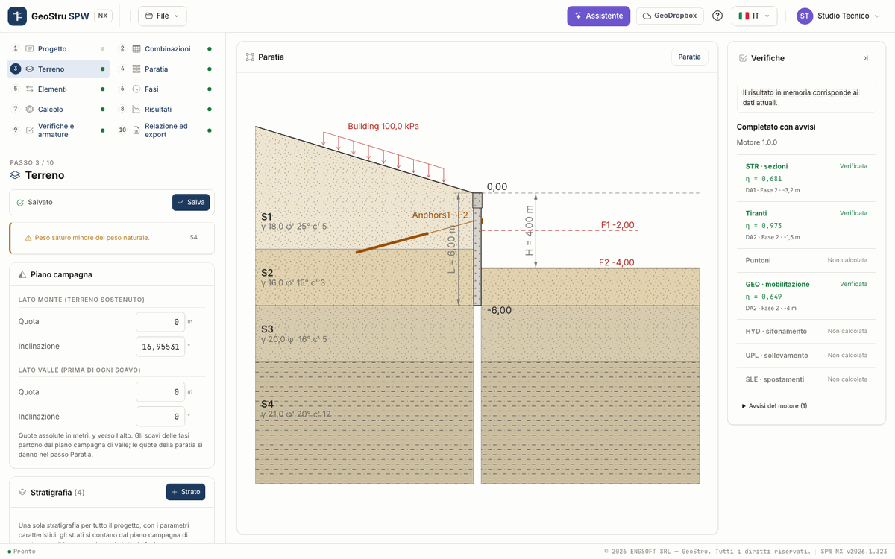
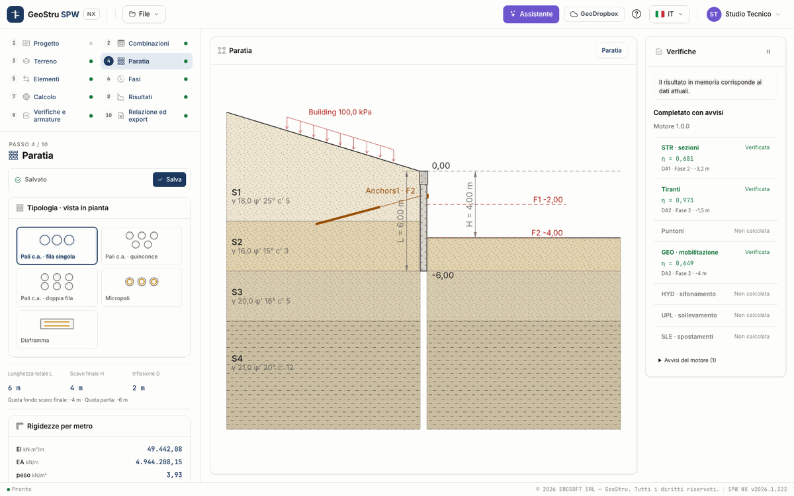
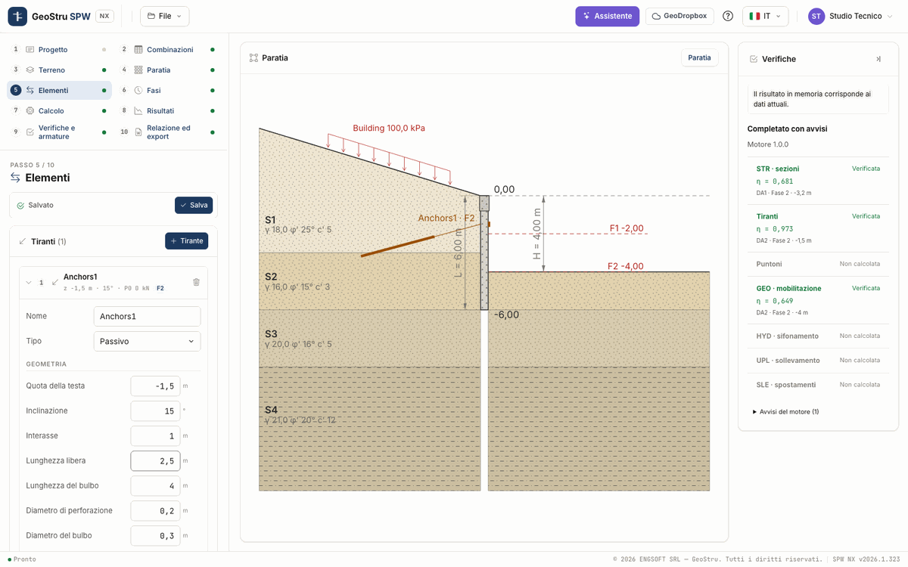

# Flusso di lavoro

Un progetto segue dieci passi. I dati a monte alimentano quelli a valle. Se cambi un ingresso dopo il calcolo, il risultato diventa **non aggiornato**: calcola di nuovo prima di usarlo.

## 0. Nuovo, esempio o file esistente

Dal menu **File** puoi:

- creare un progetto con **Nuovo**;
- aprire un `.spwnx` con **Apri…**;
- importare un `.spwx` del desktop;
- aprire uno degli esempi;
- salvare con **Salva** o **Salva con nome…**.

Il progetto resta nella sessione per 30 minuti di inattività. Salvalo in un file o su GeoDropbox.

## 1. Progetto e sito

Compila nome, descrizione, committente, cantiere, progettista e data. I dati dello studio servono per l'intestazione della relazione.

Scegli la **Normativa geotecnica** e la **Normativa strutturale**. Il cambio della normativa geotecnica rigenera le combinazioni previste e chiede conferma.

Per il sito:

1. cerca la località oppure fai clic sulla mappa;
2. controlla latitudine, longitudine e altitudine;
3. attiva o disattiva il sisma;
4. con il sisma attivo scegli vita nominale, classe d'uso, categoria di sottosuolo e categoria topografica;
5. indica lo **spostamento ammissibile** della paratia;
6. richiedi i parametri del sito oppure applica valori inseriti da te.

La tabella riporta i tempi di ritorno e i parametri di pericolosità per gli stati limite. Controlla la fonte indicata.

Se arrivi da **Atlante NX**, la posizione del sito arriva con il collegamento. Un progetto senza posizione la riceve subito. Se il progetto ha già una posizione diversa, il passo **Relazione ed export** chiede se sostituirla. Dopo la sostituzione richiedi di nuovo i parametri del sito.

## 2. Combinazioni, prima delle fasi

Definisci le combinazioni prima di descrivere la costruzione. Ogni combinazione si applica alla sequenza delle fasi. Così la stessa regola di sicurezza segue tutto il progetto.

Nella matrice **Azioni × combinazioni** controlli:

- attivazione e tipo di verifica;
- fasi comprese nell'ambito;
- coefficienti sulle azioni;
- coefficienti sui parametri del terreno;
- coefficienti sulle resistenze.

Le celle grigie vengono dalla tabella. Quelle in grassetto sono eccezioni con una motivazione. La striscia **Tabella dei coefficienti da confermare** ricorda che la tabella normativa richiede una verifica del progettista.

Dettagli in [Combinazioni](combinazioni.md).

## 3. Terreno con una stratigrafia

Imposta quota e inclinazione del piano campagna a monte e a valle. Le quote sono assolute, in metri, positive verso l'alto. Gli scavi delle fasi partono dal piano campagna di valle.

Aggiungi gli strati dall'alto verso il basso. Per ogni strato indichi:

- nome, spessore e comportamento drenato o non drenato;
- peso dell'unità di volume naturale e saturo;
- resistenza caratteristica e attrito fra terreno e parete;
- rapporto di sovraconsolidamento;
- modulo di reazione per il FEM e relativi dati;
- dati edometrici, permeabilità, inclinazione e colore fra gli altri dati.

La stratigrafia è una sola per tutto il progetto. Le fasi non ne hanno copie diverse.

Attiva la falda iniziale se presente. Indica quota a monte e a valle, regime e verifica a sifonamento.

## 4. Paratia con una tipologia

Scegli una tipologia per tutta l'altezza:

- pali in c.a. in fila singola;
- pali in c.a. a quinconce;
- pali in c.a. in doppia fila;
- micropali;
- diaframma.

Inserisci quota di testa, lunghezza e sviluppo longitudinale. Compila geometria, interassi, materiali e armatura richiesti dalla tipologia. Puoi aggiungere la trave di coronamento.

Il riepilogo mostra lunghezza totale, scavo finale e infissione. Le rigidezze e i pesi sono riferiti al metro di paratia.

## 5. Elementi con identificativo e categoria

Definisci una volta tiranti, puntoni e carichi. Li richiami nelle fasi con il loro identificativo. La definizione non li rende attivi: serve un evento nella sequenza.

- **Tiranti**: posizione, inclinazione, interasse, lunghezze, bulbo, armatura, tipo attivo o passivo, precarico, durata e resistenza.
- **Puntoni**: posizione, geometria, materiale e rigidezza assegnata o proposta.
- **Carichi**: categoria G1, G2 o Q, tipo di azione variabile, segno favorevole o sfavorevole, geometria e valore caratteristico.

La categoria determina i coefficienti nella matrice. Non inserire un coefficiente nel singolo carico.

## 6. Fasi come eventi

Ogni fase contiene eventi ordinati. Puoi scavare, rinterrare, installare o rimuovere supporti, tesare un tirante, applicare o rimuovere un carico, cambiare la falda, assegnare vincoli e pressioni.

Lo stato continua nelle fasi successive finché un evento lo cambia. Non copiare un tirante già attivo: richiedi solo ciò che accade in quella fase.

Le miniature mostrano lo stato a fine fase. Vedi [Fasi](fasi.md).

## 7. Calcolo LEM o FEM

Scegli il metodo e le teorie per spinta attiva, passiva e sismica. Per il FEM imposta analisi lineare o non lineare, discretizzazione, convergenza e limiti della risposta del terreno.

Premi **Calcola**. Il programma percorre le fasi per ogni combinazione attiva. Una combinazione non completata è esclusa dagli inviluppi e viene segnalata.

Con il **LEM** le opzioni FEM restano chiuse e non servono. Il LEM restituisce sollecitazioni, infissione di progetto e forze nei supporti, ma non gli spostamenti.

Il significato dei metodi è in [Metodi](metodi.md).

## 8. Risultati e inviluppi

Nel dettaglio scegli combinazione, fase e diagramma. Sono disponibili deformata, momento, taglio, sforzo normale, pressioni, modulo di reazione e mobilitazione passiva quando pertinenti.

Gli inviluppi cercano gli estremi fra le condizioni calcolate. La colonna **Combinazione · fase · quota** dice dove nasce ogni valore.

Per le verifiche strutturali i valori concomitanti restano insieme. Non combinare un momento massimo con uno sforzo normale preso da un'altra condizione.

## 9. Verifiche e armature

Controlla:

- resistenza a flessione e taglio delle sezioni;
- sfruttamento dei tiranti per sfilamento e resistenza dell'acciaio;
- resistenza dei puntoni;
- mobilitazione passiva;
- sifonamento e sollevamento quando richiesti;
- spostamenti rispetto al limite del progetto.

Leggi gli avvisi e le voci **Non calcolata**. L'instabilità dei puntoni, la stabilità globale, il carico limite verticale e le verifiche SLE delle sezioni non sono disponibili.

## 10. Relazione, DXF e collegamenti

Il passo **Relazione ed export** raccoglie le uscite del progetto. I comandi si attivano con un calcolo completo e aggiornato.

- **Anteprima gratuita** mostra al centro la relazione con indice, tabelle e figure. Il codice documento si assegna solo al download.
- **Scarica Word** produce la relazione `.docx`: dati generali, sito, combinazioni con le eccezioni, terreno, paratia, elementi, fasi, metodo, risultati, inviluppi, verifiche, armature, rapporto di importazione, avvisi del motore e il blocco «Codice di calcolo».
- **Tavola DXF: sezione, fasi e inviluppi** produce la tavola completa; **Solo sezione della paratia** il solo disegno della sezione.

Word e DXF costano 10 crediti ciascuno e si pagano solo a file prodotto. Il DXF del diagramma a video si richiede anche dal passo Risultati.

**Collegamenti NX**

- **Computo NX** riceve le voci della paratia. Apri **Parametri e anteprima computo** per scegliere sviluppo longitudinale, sovrapposizioni e sfridi dell'acciaio e regione del prezzario, aggiornare le quantità e togliere le voci che non vuoi trasferire.
- **PDM NX** riceve la descrizione dell'opera per il piano di manutenzione.
- **CAD Tools** riceve le viste della paratia per l'editing (10 crediti per l'insieme delle viste).

L'app di destinazione si apre in una nuova scheda, passando dall'accesso unico GeoStru. Computo NX e PDM NX non comportano addebiti da SPW. Lo scambio della stratigrafia con Stratigrapher NX non è disponibile: gli strati si inseriscono nel passo Terreno.

---

*Hai trovato un errore in questa pagina? [Segnalacelo](mailto:info@geostru.ai) o apri una [Pull Request](https://github.com/EngSoft-Geostru/geostru-help-nx/edit/main/spw/docs/it/workflow.md).*
